<html lang="ja"><head><meta charset="utf-8"><meta name="viewport" content="width=device-width,initial-scale=1"><title>パンダの笑える英語日記｜イラストで楽しむ英会話</title><meta name="description" content="ぬいぐるみパンダのユーモラスな日常を日本語と英語で楽しむ英語学習日記。英会話フレーズ、発音記号、英語音声付き。"><link rel="canonical" href="https://papan2222.github.io/blog/"><meta property="og:title" content="パンダの笑える英語日記"><meta property="og:description" content="パンダの珍生活を日本語と英語で。音声と英会話フレーズ付き。"><meta property="og:type" content="website"><meta property="og:url" content="https://papan2222.github.io/blog/"><meta property="og:image" content="https://papan2222.github.io/images/2026-1120-1.jpg"><meta name="twitter:card" content="summary_large_image"><link rel="preconnect" href="https://fonts.googleapis.com"><link rel="preconnect" href="https://fonts.gstatic.com" crossorigin><link href="https://fonts.googleapis.com/css2?family=Dela+Gothic+One&family=Yusei+Magic&display=swap" rel="stylesheet"></head><body><header><a href="/">← ホーム</a>
THE PANDA COMEDY CLUB
<h1>パンダの笑える英語日記</h1>
まじめに生きて、なぜか笑える。

SERIOUS PANDA. RIDICULOUS LIFE.
</header><main>
<input id="search" type="search" placeholder="英単語で検索" aria-label="英単語で検索"><button id="random" class="random">🎲 おまかせ一話</button><select id="order" aria-label="表示順"><option value="original">登録順</option><option value="random">ランダム</option></select><select id="mode" aria-label="表示言語"><option value="both">日本語＋英語</option><option value="en">英語だけ</option><option value="ja">日本語だけ</option></select>
<section class="feature" id="feature">
本日の珍場面

</section>

<article class="work" id="2026-1120-1">

🐼 おぉ..笹にも劣らぬ味よ。これが新米のコシヒカリか..

🐼 Mmm... Just as tasty as bamboo! So this is freshly harvested rice!

ENGLISH TIP

<strong class="term">freshly harvested</strong> /ˈfreʃli ˈhɑrvəstɪd/

収穫したばかりの

<strong class="term">tasty</strong> /ˈteɪsti/

おいしい

<strong class="term">just as ～ as</strong> /dʒʌst æz/

～と同じくらい

</article>
<article class="work" id="2026-1120-0"><a href="#2026-1120-0">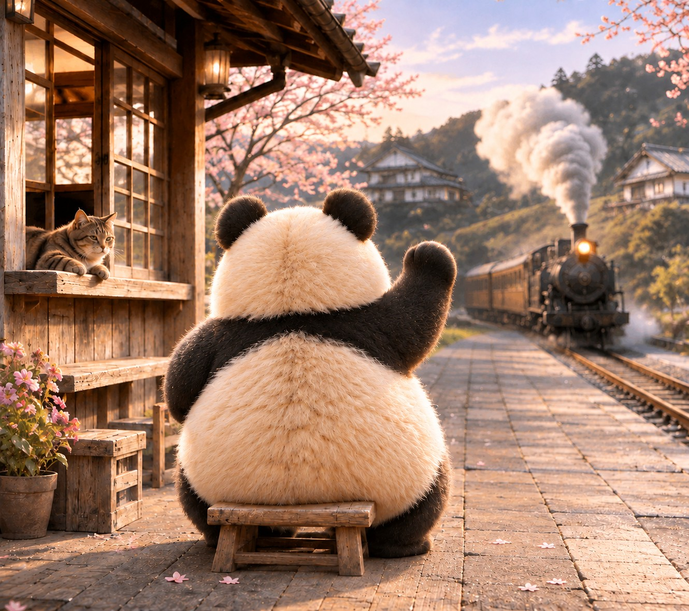</a>

🐼 列車さーん！パンダはここでーす！

🐱 このクマ...

🐼 Hey, train! Over here! I'm right here!

🐱 This bear...

ENGLISH TIP

<strong class="term">over here</strong> /ˈoʊvər hɪr/

こっちだよ

<strong class="term">right here</strong> /raɪt hɪr/

まさにここ

<strong class="term">train</strong> /treɪn/

列車

</article>
<article class="work" id="2026_1119_0"><a href="#2026_1119_0">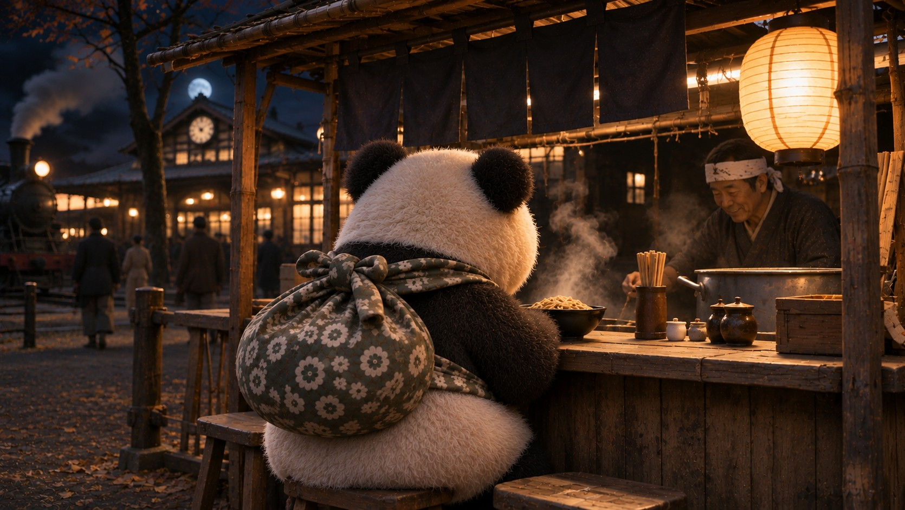</a>

🐼 こんなに大盛りにしてもらっていいんですか？

👨 腹減ってんだろ？遠慮すんない

🐼 ありがとうございます..

🐼 Isn't this a bit much?

👨 You look hungry. Eat up.

🐼 Thank you... sniff

ENGLISH TIP

<strong class="term">eat up</strong> /it ʌp/

残さず食べる、さあ食べて

<strong class="term">a bit much</strong> /ə bɪt mʌtʃ/

少し多すぎる

<strong class="term">hungry</strong> /ˈhʌŋɡri/

空腹の

</article>
<article class="work" id="2026-0425-1"><a href="#2026-0425-1">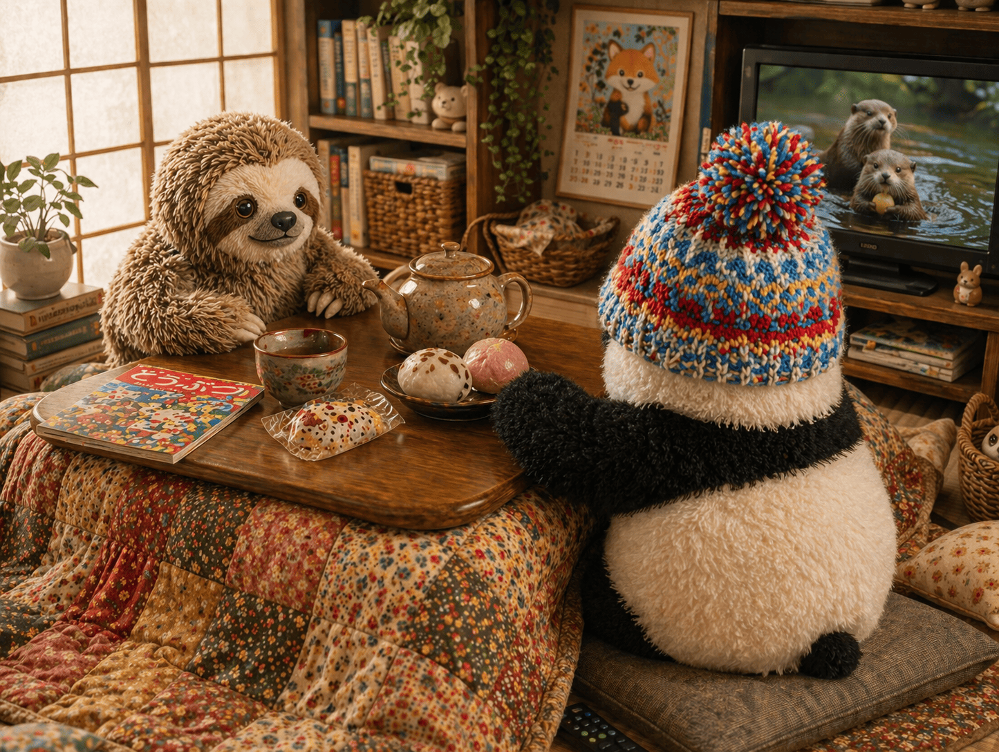</a>

🐼 今日なにした？

🦥 “何もしなかった”をやり切った

🐼 What did you do today?

🦥 I fully committed to doing nothing.

ENGLISH TIP

<strong class="term">commit to</strong> /kəˈmɪt tu/

～に専念する。to の後は名詞や動名詞。

<strong class="term">fully</strong> /ˈfʊli/

完全に

<strong class="term">do nothing</strong> /du ˈnʌθɪŋ/

何もしない

<strong class="term">commit to doing</strong> /kəˈmɪt tə ˈduɪŋ/

～することに専念する。to の後は動名詞。

</article>
<article class="work" id="2026-0418-0"><a href="#2026-0418-0">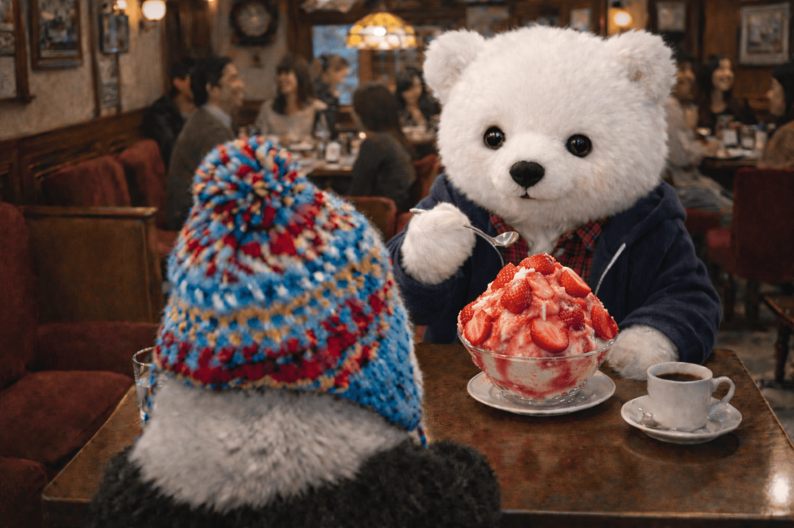</a>

🐻‍❄️ いちご極盛り氷。これが楽しみで生きてる。

🐼 シロクマくん.. やっぱり、ニチレイの焼売も凍ったままいく？

🐻‍❄️ Strawberry shaved ice. I live for this.

🐼 Polar bear… so, do you eat frozen dumplings straight from the freezer too?

ENGLISH TIP

<strong class="term">straight from</strong> /streɪt frəm/

～から直接

<strong class="term">shaved ice</strong> /ʃeɪvd aɪs/

かき氷

<strong class="term">frozen</strong> /ˈfroʊzən/

冷凍された

</article>
<article class="work" id="2026-04-06"><a href="#2026-04-06">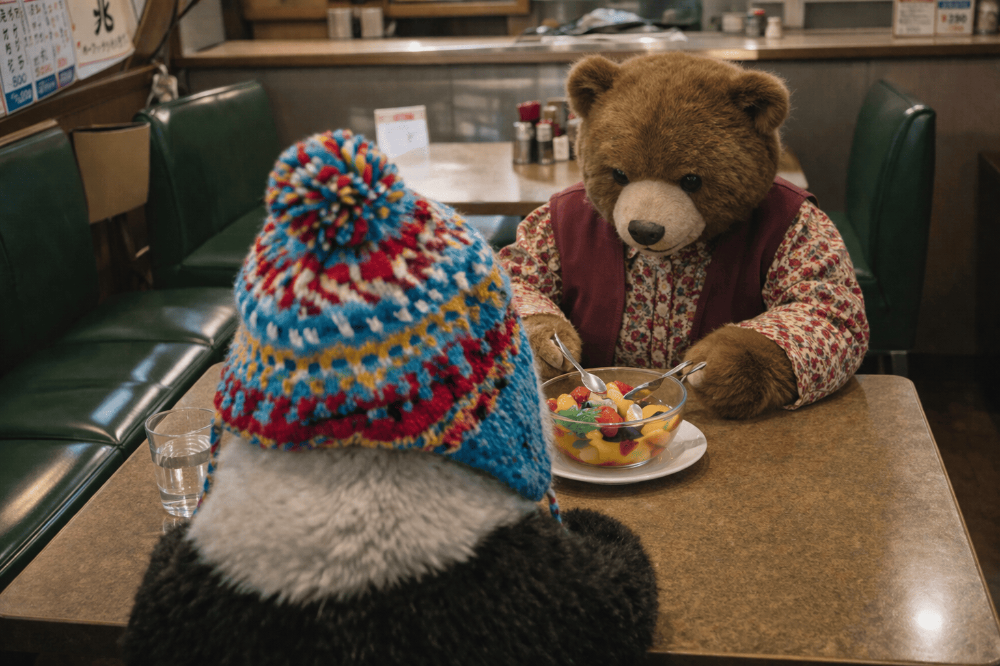</a>

🐻 この店のフルーツポンチ、うまいんだよ。

🐼 ポンチってどの色のやつ？おくれよ

🐻 The fruit punch here is really good.

🐼 Which one’s the “punch”? I want that one.

ENGLISH TIP

<strong class="term">fruit punch</strong> /frut pʌntʃ/

フルーツ入りの飲み物

<strong class="term">which one</strong> /wɪtʃ wʌn/

どれ

<strong class="term">really good</strong> /ˈriəli ɡʊd/

とてもおいしい

</article>
<article class="work" id="2026-0314-0"><a href="#2026-0314-0">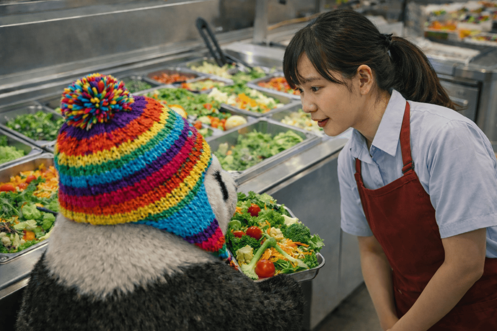</a>

👧 お客様、トレーごとはちょっと..

🐼 どうせ全部たべるよ。たけのこ入ってる？

👧 Sir… not the whole tray, please.

🐼 I’ll eat it all anyway. Any bamboo shoots in here?

ENGLISH TIP

<strong class="term">anyway</strong> /ˈeniweɪ/

いずれにせよ

<strong class="term">whole tray</strong> /hoʊl treɪ/

トレー全部

<strong class="term">bamboo shoot</strong> /bæmˈbu ʃut/

タケノコ

</article>
<article class="work" id="2026-0225-0"><a href="#2026-0225-0">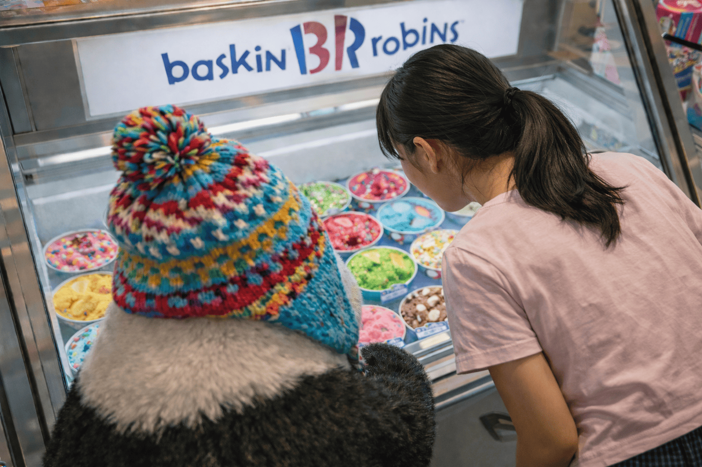</a>

🐼 俺 ラブラブポーションサーティワンとベリーベリーストロベリーのレギュラーダブルでワッフルコーンにする

👧 目一杯きたね..あんた

🐼 I’ll get a double. Love Potion and Very Berry Strawberry, waffle cone.

👧 You’re really going all the way.

ENGLISH TIP

<strong class="term">go all the way</strong> /ɡoʊ ɔl ðə weɪ/

徹底的にやる

<strong class="term">double</strong> /ˈdʌbəl/

ダブル、二つ分

<strong class="term">waffle cone</strong> /ˈwɑfəl koʊn/

ワッフルコーン

</article>
<article class="work" id="2026-0219-1"><a href="#2026-0219-1">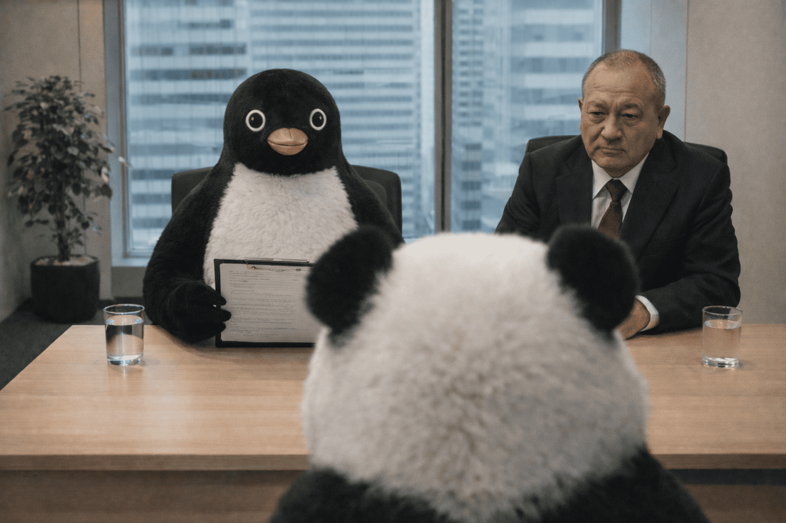</a>

🐼　Suicaの新しいキャラに応募したパンダといいます！

🐧　ほぅ。私の代わりが君に務まるかな？

🐼 I’m a panda applying to be the new Suica character.

🐧 Oh? Think you can replace me?

ENGLISH TIP

<strong class="term">replace</strong> /rɪˈpleɪs/

取って代わる

<strong class="term">apply to be</strong> /əˈplaɪ tə bi/

～になるため応募する

<strong class="term">character</strong> /ˈkærəktər/

キャラクター

</article>
<article class="work" id="2026-0218-0"><a href="#2026-0218-0">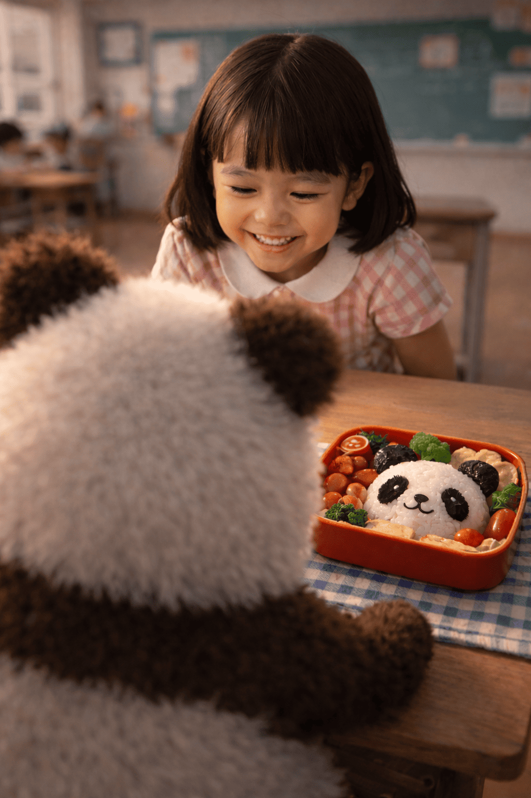</a>

👧 自分の顔のお弁当って、ずいぶん自信家ね。

🐼 自己承認欲求を、昼で満たすんだよ。

👧 Your face in a bento? That’s confident.

🐼 Lunch is when I handle my self-validation.

ENGLISH TIP

<strong class="term">self-validation</strong> /self ˌvælɪˈdeɪʃən/

自己肯定

<strong class="term">confident</strong> /ˈkɑnfɪdənt/

自信がある

<strong class="term">handle</strong> /ˈhændəl/

対処する

</article>
<article class="work" id="2026-0211-2"><a href="#2026-0211-2">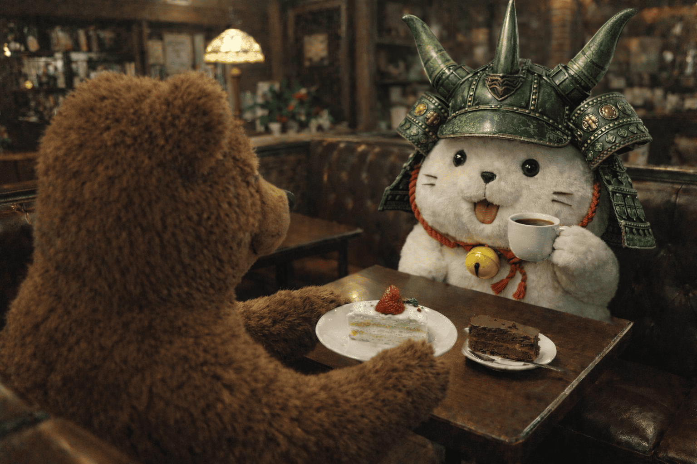</a>

🐻 ケーキ、一口でいける。...その兜 ひこにゃん意識してんの？

🐱 うっせぇ。偶然セカストにあった

🐻 I’ll finish this cake in one bite. By the way… that helmet’s a Hikonyan thing, right?

🐱 Shut up. I just found it at a thrift store.

ENGLISH TIP

<strong class="term">in one bite</strong> /ɪn wʌn baɪt/

一口で

<strong class="term">by the way</strong> /baɪ ðə weɪ/

ところで

<strong class="term">thrift store</strong> /θrɪft stɔr/

中古品店

</article>
<article class="work" id="2026-0211-1"><a href="#2026-0211-1">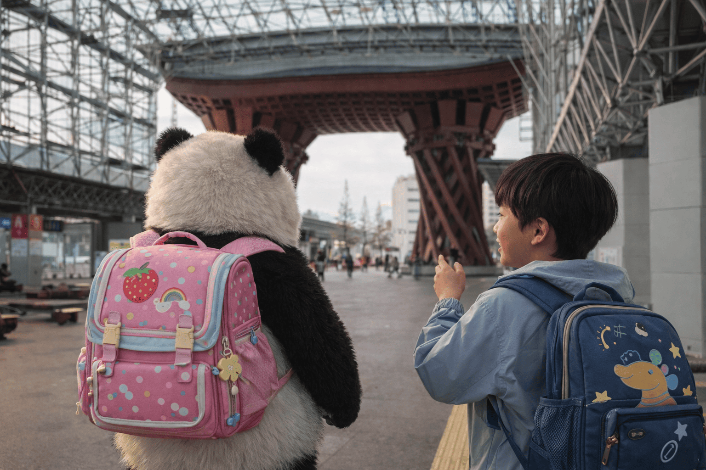</a>

👦　これが鼓門！金沢駅って大きいねぇ

🐼　うん…でも、僕のリュックのほうが目立ってる気がする

👦　This is the Tsuzumi Gate! Kanazawa Station is huge, isn’t it?

🐼　Yeah…but I think my backpack is louder.

ENGLISH TIP

<strong class="term">backpack</strong> /ˈbækpæk/

リュック

<strong class="term">huge</strong> /hjudʒ/

巨大な

<strong class="term">loud</strong> /laʊd/

音や見た目が派手な

</article>
<article class="work" id="2026-0206-1">

👵パンダと一緒なんて.. すごい冥土の土産ができたわ

🐼このまま直行じゃないですよね..冥土に..

👵 A panda, of all things… what an afterlife souvenir.

🐼 We’re not going straight there, right…?

ENGLISH TIP

<strong class="term">of all things</strong> /əv ɔl θɪŋz/

よりによって

<strong class="term">afterlife</strong> /ˈæftərlaɪf/

死後の世界

<strong class="term">souvenir</strong> /ˌsuvəˈnɪr/

土産

</article>
<article class="work" id="2026-0202-0"><a href="#2026-0202-0">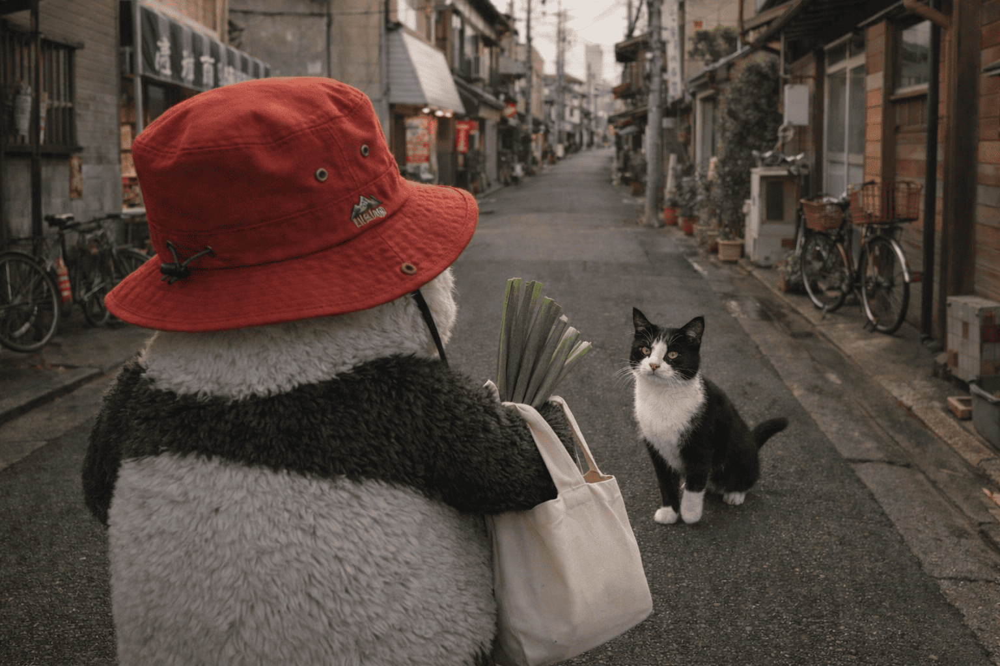</a>

🐼 鍋にするけど、一緒にどうだい？

🐱 （こいつ白黒ニャ... 親近感あるニャ...）

🐼 Hot pot tonight. Care to join?

🐱 (Black and white… huh. Oddly relatable.)

ENGLISH TIP

<strong class="term">care to join</strong> /ker tə dʒɔɪn/

ご一緒しませんか

<strong class="term">hot pot</strong> /hɑt pɑt/

鍋料理

<strong class="term">relatable</strong> /rɪˈleɪtəbəl/

共感できる

</article>
<article class="work" id="2026-01-28-1"><a href="#2026-01-28-1">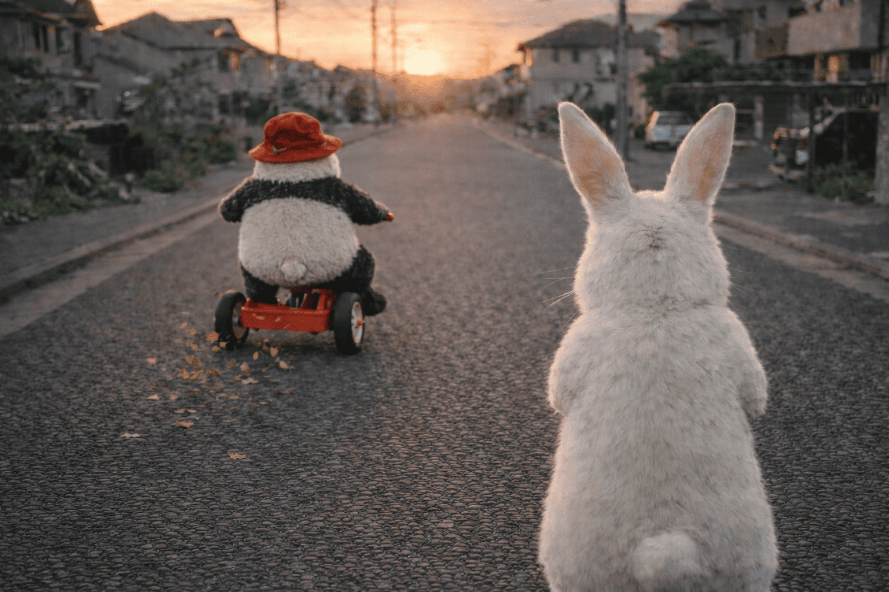</a>

ウサギのバイクで逃げ出そう

枯れ葉を舞い上げて

-- スピッツ「ウサギのバイク」

Let’s flee on the rabbit’s bike,

dry leaves rising behind us.

ENGLISH TIP

<strong class="term">flee</strong> /fli/

逃げる

<strong class="term">dry leaves</strong> /draɪ livz/

枯れ葉

<strong class="term">rise</strong> /raɪz/

舞い上がる

</article>
<article class="work" id="2026-0127-0"><a href="#2026-0127-0">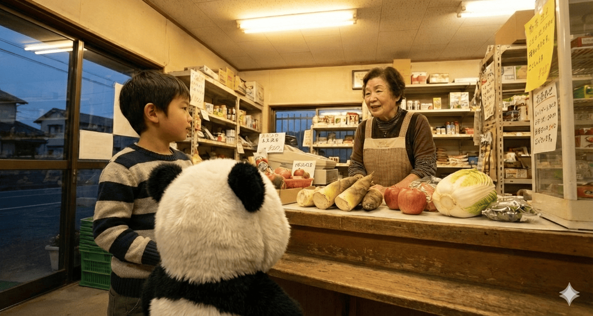</a>

👦 竹の子のお菓子ってありますか？

🐼 厚切りのチップスがベストです。

👦 Do you have any bamboo-shoot snacks?

🐼 Thick-cut chips would be best.

ENGLISH TIP

<strong class="term">thick-cut</strong> /θɪk kʌt/

厚切りの

<strong class="term">snack</strong> /snæk/

軽食、お菓子

<strong class="term">would be best</strong> /wʊd bi best/

～が一番よいだろう

</article>
<article class="work" id="2026-0123-0"><a href="#2026-0123-0">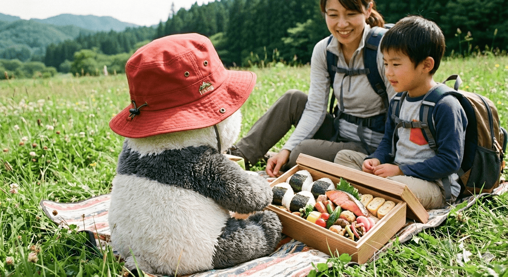</a>

👦 まだ頂上じゃないんだよ、パンダ

🐼 小腹空いて.. おにぎり一つだけだよ

👦 We’re not at the top yet, Panda.

🐼 I know… just a little hungry. I’ll just have one rice ball.

ENGLISH TIP

<strong class="term">not yet</strong> /nɑt jet/

まだ～していない

<strong class="term">at the top</strong> /æt ðə tɑp/

頂上に

<strong class="term">rice ball</strong> /raɪs bɔl/

おにぎり

</article>
<article class="work" id="2026-0122-0"><a href="#2026-0122-0">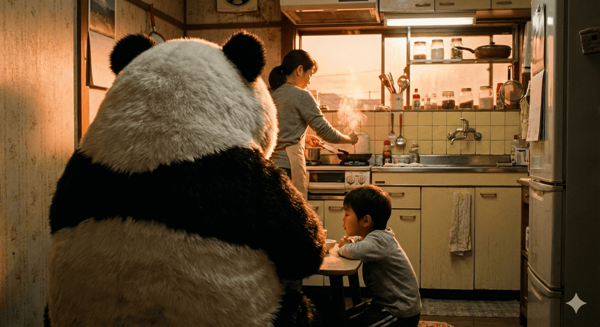</a>

👩 今日は竹の子ハンバーグよ

🐼 もう鼻で食べてます

👦 お腹すいたぁ

👩 We’re having bamboo shoot hamburg steaks today.

🐼 I’m eating with my nose for now.

👦 I’m hungry!

ENGLISH TIP

<strong class="term">for now</strong> /fər naʊ/

とりあえず今は

<strong class="term">have ～ today</strong> /hæv təˈdeɪ/

今日は～を食べる

<strong class="term">nose</strong> /noʊz/

鼻

</article>
<article class="work" id="2026-01-12-1"><a href="#2026-01-12-1">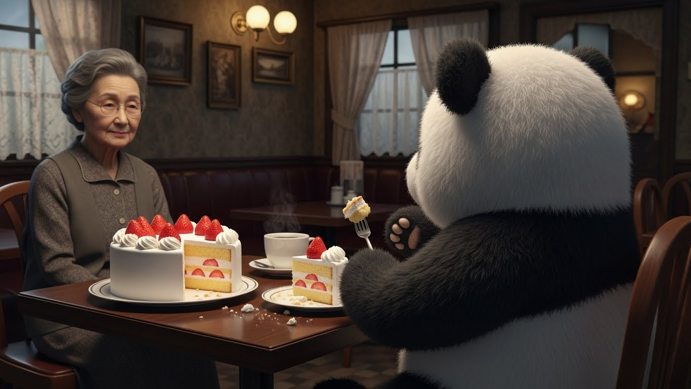</a>

🐼
これ、シャトレーゼのやつでしょう？わかりますよ、菊栄さん。

👵
何が言いたいのかしら？

🐼
This is from Châteraisé, right? I can tell, Mrs. Kikue.

👵
And what exactly are you trying to say?

ENGLISH TIP

<strong class="term">I can tell</strong> /aɪ kən tel/

見ればわかる

<strong class="term">exactly</strong> /ɪɡˈzæktli/

いったい、正確に

<strong class="term">try to say</strong> /traɪ tə seɪ/

言おうとする

</article>
<article class="work" id="2026-01-12-2"><a href="#2026-01-12-2">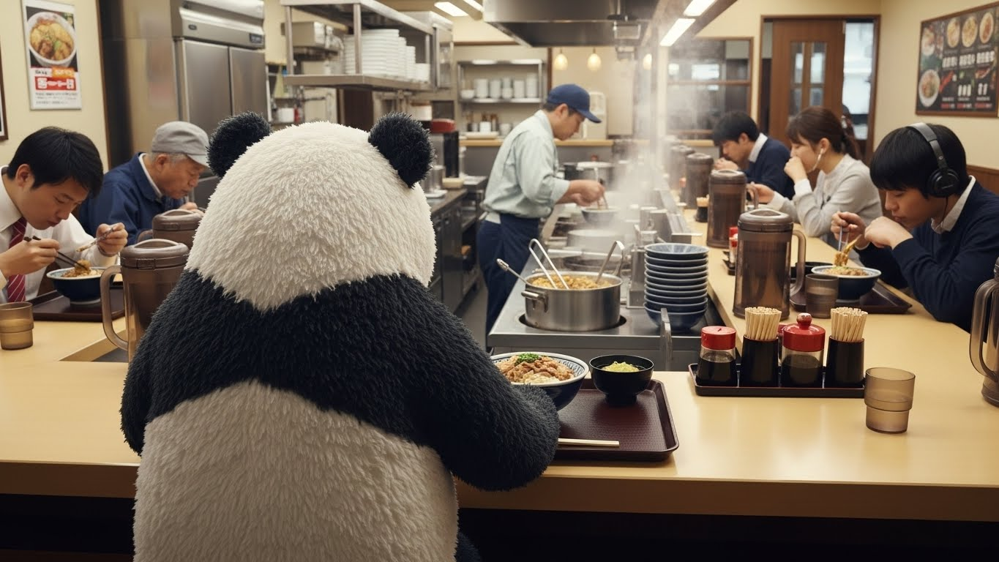</a>

🐼
親父さん！瓶ビールと、おつまみメンマ３つ追加で！

👨‍🍳
あいよっ！シャオシャオ、いつもありがとね！

🐼
Boss! One bottled beer, and three orders of menma on the side!

👨‍🍳
You got it! Thanks as always, Shao Shao!

ENGLISH TIP

<strong class="term">on the side</strong> /ɑn ðə saɪd/

付け合わせとして

<strong class="term">bottled beer</strong> /ˈbɑtəld bɪr/

瓶ビール

<strong class="term">You got it</strong> /ju ɡɑt ɪt/

了解しました

</article>
<article class="work" id="2026-01-12-0"><a href="#2026-01-12-0">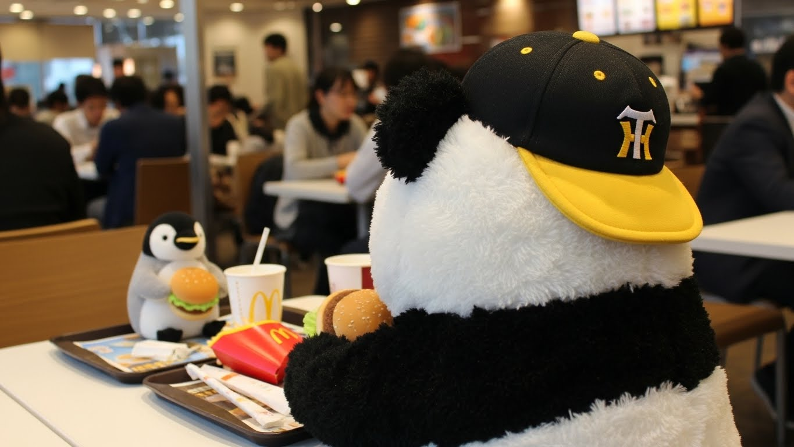</a>

🐼
お前のバーガー、小さくない？

🐧
丸飲み用だ。俺は咀嚼しないんだ。

🐼
そっか。俺のポテト、食べていいよ。

🐧
喉に詰まるだろ！

🐼
Isn’t your burger kind of small?

🐧
It’s for swallowing. I don’t chew.

🐼
Oh. You can have my fries, then.

🐧
They’d get stuck.

ENGLISH TIP

<strong class="term">get stuck</strong> /ɡet stʌk/

引っかかる

<strong class="term">swallow</strong> /ˈswɑloʊ/

飲み込む

<strong class="term">chew</strong> /tʃu/

かむ

</article>
<article class="work" id="2026-01-06-1"><a href="#2026-01-06-1">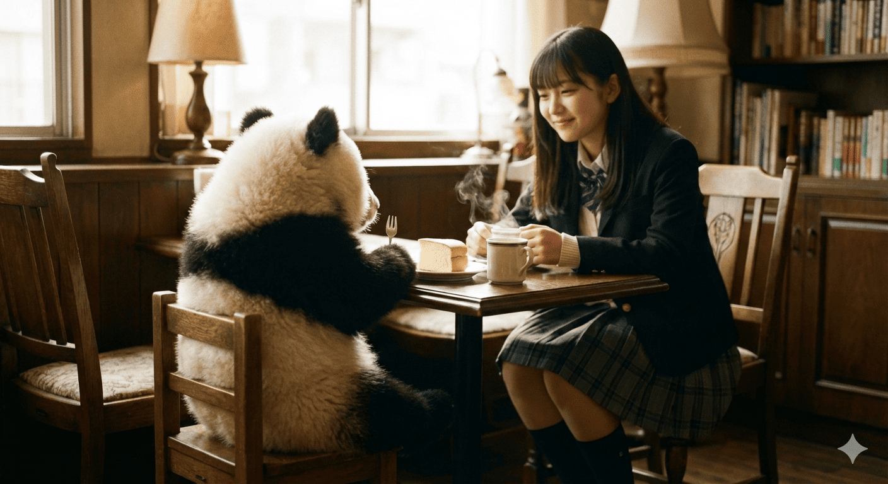</a>

👧
パンダちゃん❤ チーズケーキっていうのよ、これ。

🐼
難しい名前のおやつは、だいたいおいしい。

👧
Panda, this is called cheesecake.

🐼
Snacks with hard names are usually tasty.

ENGLISH TIP

<strong class="term">usually</strong> /ˈjuʒuəli/

たいてい

<strong class="term">be called</strong> /bi kɔld/

～と呼ばれる

<strong class="term">tasty</strong> /ˈteɪsti/

おいしい

</article>
<article class="work" id="2026-01-09-0"><a href="#2026-01-09-0">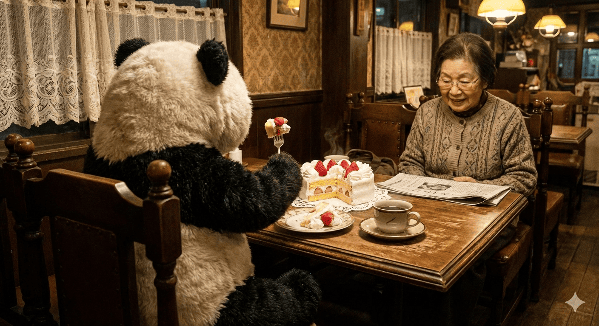</a>

👵
上野動物園から逃げて、これからどうするの？

🐼
モグモグ... 京都の嵯峨野の竹林は見事らしいんです。そこに潜伏します

👵
You escaped from Ueno Zoo. What now?

🐼
Nom nom… I hear Kyoto’s Sagano bamboo grove is nice.
I might hide there.

ENGLISH TIP

<strong class="term">grove</strong> /ɡroʊv/

小さな林

<strong class="term">escape from</strong> /ɪˈskeɪp frəm/

～から逃げる

<strong class="term">hide</strong> /haɪd/

隠れる

</article>
<article class="work" id="2026-01-05-0"><a href="#2026-01-05-0">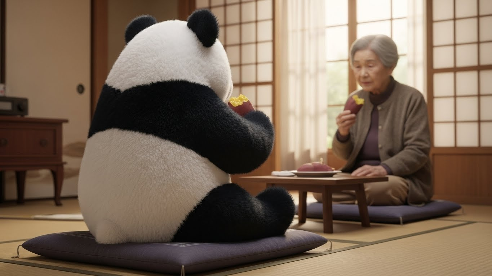</a>

🐼
焼いた芋も 美味しいものですね。
ただ、失敬ですが、おならがでそうです。

👵
あら、人間と同じなのねぇ

🐼
Roasted sweet potatoes are really good.
Sorry to say this, but I think I’m about to fart.

👵
Oh my. Just like a human, then.

ENGLISH TIP

<strong class="term">be about to</strong> /bi əˈbaʊt tu/

今にも～しそう

<strong class="term">roasted</strong> /ˈroʊstɪd/

焼いた

<strong class="term">fart</strong> /fɑrt/

おならをする（くだけた語）

</article>
<article class="work" id="2026-01-02-0"><a href="#2026-01-02-0">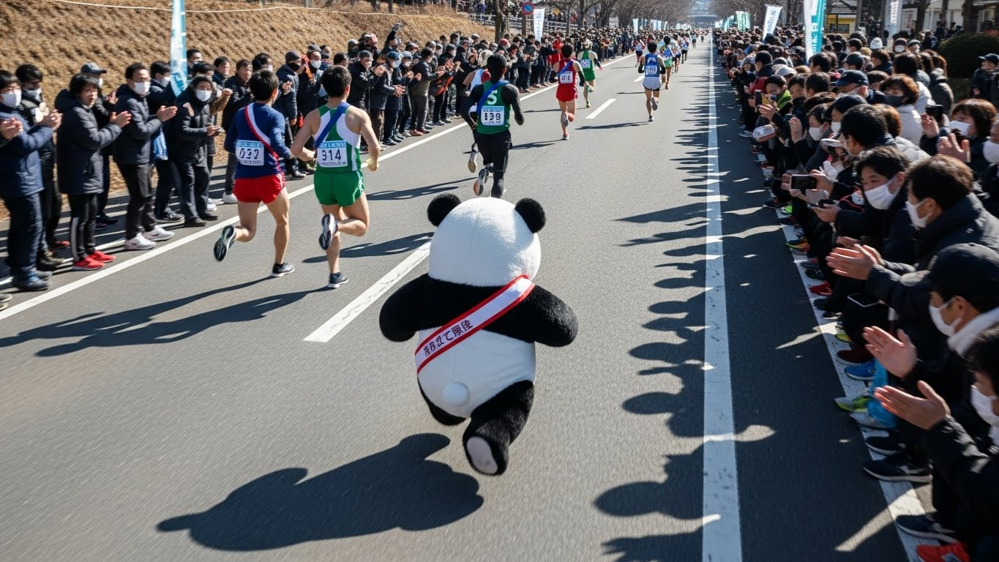</a>

箱根駅伝、花の２区！

動物大学のパンダ、健闘しています！

It’s the famous Section 2 of the Hakone Ekiden.

The panda from Animal University is putting up a great fight!

ENGLISH TIP

<strong class="term">put up a fight</strong> /pʊt ʌp ə faɪt/

健闘する

<strong class="term">section</strong> /ˈsekʃən/

区間

<strong class="term">famous</strong> /ˈfeɪməs/

有名な

</article>
<article class="work" id="2025-12-21-1"><a href="#2025-12-21-1">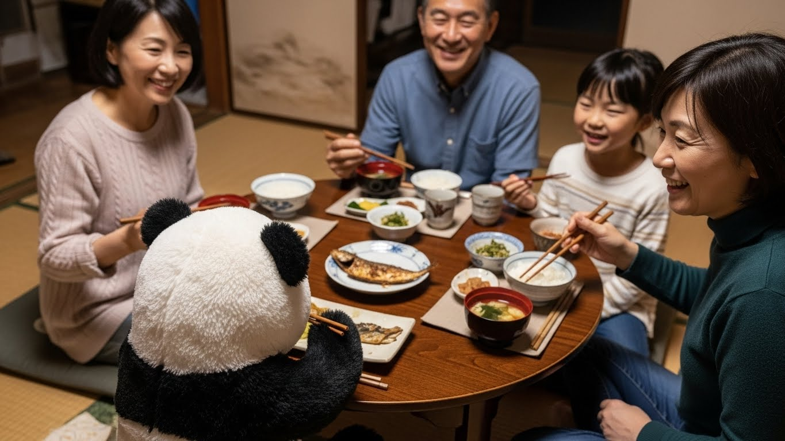</a>

🐼
この焼き魚、とてもおいしいです。

👩
そうでしょう！たけのこ以外にもおいしいものはたくさんあるのよ。

🐼
This grilled fish is delicious.

👩
See? There’s plenty of good food besides bamboo.

ENGLISH TIP

<strong class="term">besides</strong> /bɪˈsaɪdz/

～に加えて

<strong class="term">grilled</strong> /ɡrɪld/

焼いた

<strong class="term">plenty of</strong> /ˈplenti əv/

たくさんの

</article>
<article class="work" id="2025-12-15-1"><a href="#2025-12-15-1">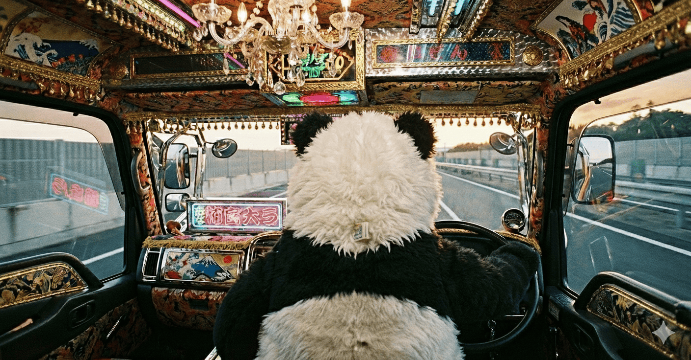</a>

白黒の人生を生きてやる、俺の視界に『グレー』なんて色はねぇ

Living life in black and white, No shades of gray in my sight.

ENGLISH TIP

<strong class="term">shade</strong> /ʃeɪd/

色合い、陰影

<strong class="term">in my sight</strong> /ɪn maɪ saɪt/

私の視界に

<strong class="term">black and white</strong> /blæk ən waɪt/

白黒

</article>
<article class="work" id="2025-12-15-0"><a href="#2025-12-15-0">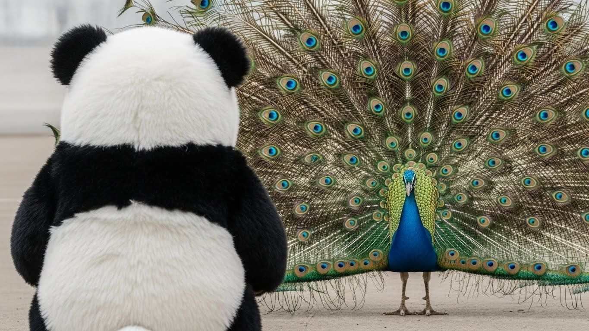</a>

🦚
クククッ... おまえ、動揺しているだろう？

🐼
いや、畳むの面倒くさそうだなって思ってる

🦚
Heh… you’re shaken, aren’t you?

🐼
Nope. I was just thinking how annoying that must be to fold.

ENGLISH TIP

<strong class="term">annoying</strong> /əˈnɔɪɪŋ/

面倒な、いらいらさせる

<strong class="term">shaken</strong> /ˈʃeɪkən/

動揺した

<strong class="term">fold</strong> /foʊld/

折りたたむ

</article>
<article class="work" id="2025-11-28-0"><a href="#2025-11-28-0">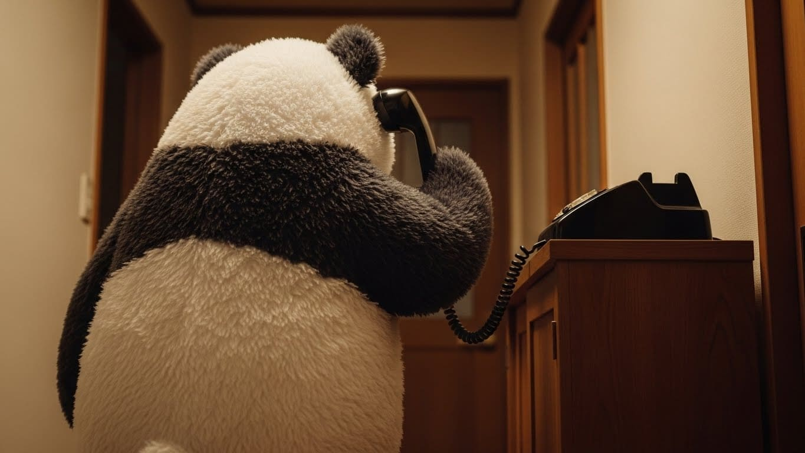</a>

🐼 もしもし。来来軒？
三丁目のパンダです。
八宝菜５つ、たけのこ２倍でお願いします。

🐼 Hi, Rairaiken?
Panda from Third Street.
Five Eight-Treasure stir-fries, double bamboo shoots.

ENGLISH TIP

<strong class="term">stir-fry</strong> /ˈstɜr fraɪ/

炒め物

<strong class="term">double</strong> /ˈdʌbəl/

倍量

<strong class="term">order</strong> /ˈɔrdər/

注文（関連語）

</article>
<article class="work" id="2025-11-20-0"><a href="#2025-11-20-0">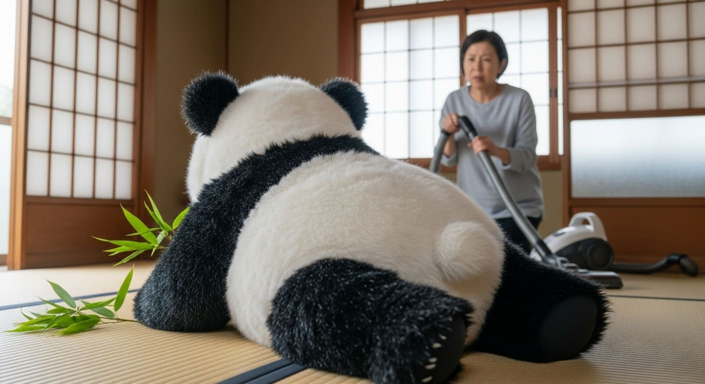</a>

👩
掃除機かけるからどいてくれる？

🐼
あ、お母さん。お昼はもうすぐ？

👩
Can you move a bit? I’m trying to vacuum.

🐼
Oh, ma’am… is it almost lunchtime?

ENGLISH TIP

<strong class="term">vacuum</strong> /ˈvækjuəm/

掃除機をかける

<strong class="term">move a bit</strong> /muv ə bɪt/

少し動く

<strong class="term">almost</strong> /ˈɔlmoʊst/

もう少しで

</article>
<article class="work" id="2025-11-18-0"><a href="#2025-11-18-0">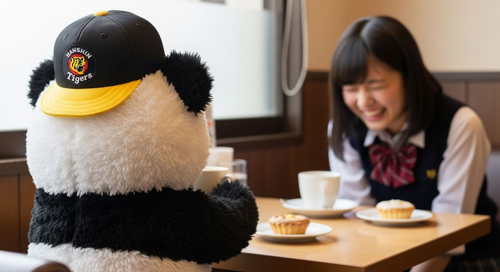</a>

🐼
ワシ虎党やけど、分類はクマ科やで？

🐼
I'm a die-hard Tigers fan… but biologically, I'm still a bear, you know?

ENGLISH TIP

<strong class="term">die-hard</strong> /ˈdaɪ hɑrd/

熱烈な

<strong class="term">biologically</strong> /ˌbaɪəˈlɑdʒɪkli/

生物学的には

<strong class="term">still</strong> /stɪl/

依然として

</article>
<article class="work" id="2025-0927-04"><a href="#2025-0927-04">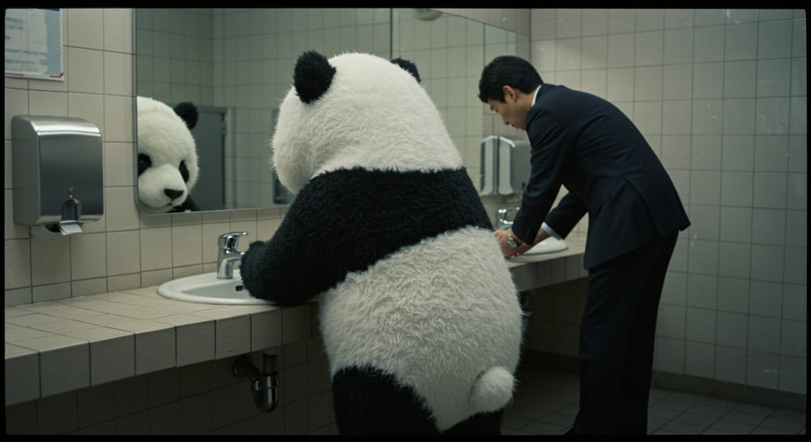</a>

🐼
パンダのうんちって、ほんとに良い匂いなんだ。植物の香り。

だから、流してないよ。

🐼
Takahashi, you know, panda poop actually smells nice—like plants.

So… I didn’t flush.

ENGLISH TIP

<strong class="term">flush</strong> /flʌʃ/

トイレの水を流す

<strong class="term">actually</strong> /ˈæktʃuəli/

実は

<strong class="term">smell nice</strong> /smel naɪs/

よいにおいがする

</article>
<article class="work" id="2025-0927-02"><a href="#2025-0927-02">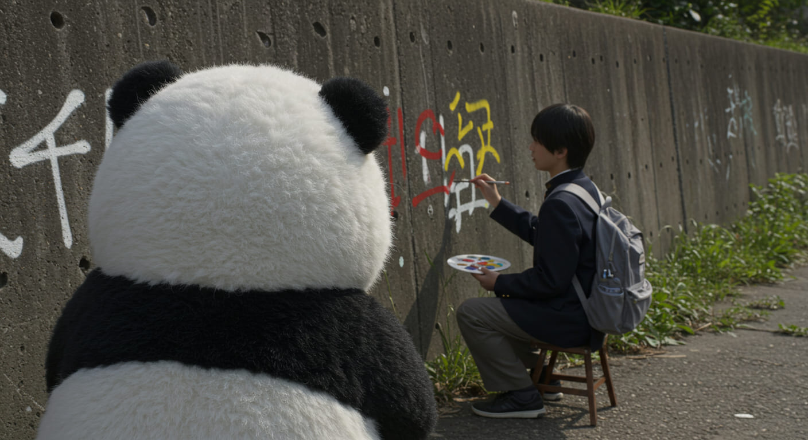</a>

🐼
そういうのはヤンキーがスプレーでやるもんだぞ。

👦
パンダにわかってたまるか。

🐼 That’s the kind of thing punks do with spray cans.

👦 What would a panda know about that?

ENGLISH TIP

<strong class="term">spray can</strong> /spreɪ kæn/

スプレー缶

<strong class="term">punk</strong> /pʌŋk/

不良、若者

<strong class="term">What would ～ know?</strong> /wʌt wʊd noʊ/

～に何がわかるというのか

</article>
<article class="work" id="2025-0927-01"><a href="#2025-0927-01">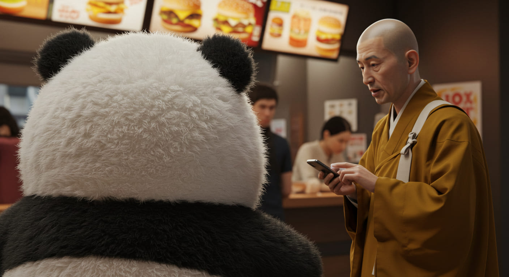</a>

🦲
あなたはダブチ３つでいいんですね？

🐼
おぅ！あと、マイメロのマックフルーリーも！

🦲 So, three Double Cheeseburgers for you?

🐼 Yeah! And one My Melody McFlurry, too!

ENGLISH TIP

<strong class="term">for you</strong> /fər ju/

あなたの分として

<strong class="term">too</strong> /tu/

～もまた

<strong class="term">cheeseburger</strong> /ˈtʃizbɜrɡər/

チーズバーガー

</article>
<article class="work" id="2025-0921-02"><a href="#2025-0921-02">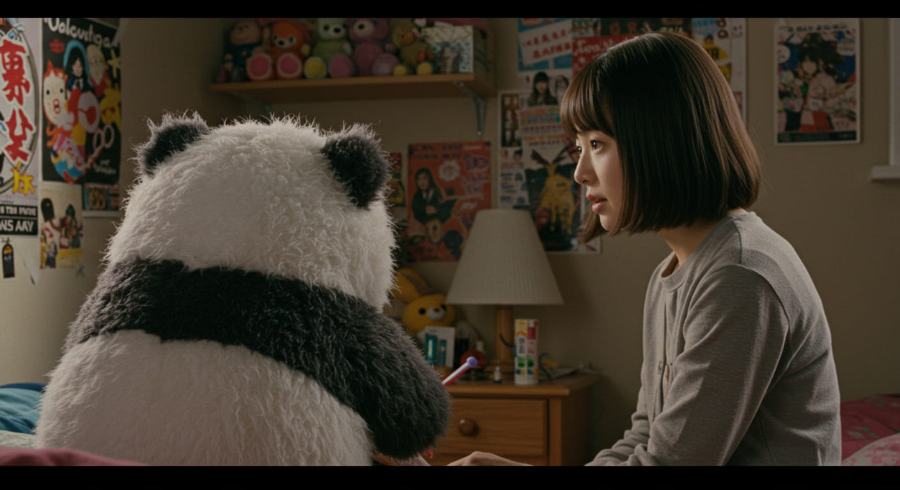</a>

👩　どうして、勝手にお風呂に入るのよ？

🐼　だって... 一番風呂に入ってみたくて...

👩 Why did you sneak into the bath?

🐼 Because… I wanted to be the first one in.

ENGLISH TIP

<strong class="term">sneak into</strong> /snik ˈɪntu/

こっそり入り込む

<strong class="term">bath</strong> /bæθ/

風呂

<strong class="term">the first one in</strong> /ðə fɜrst wʌn ɪn/

最初に入る人

</article>
<article class="work" id="2025-0921-01"><a href="#2025-0921-01">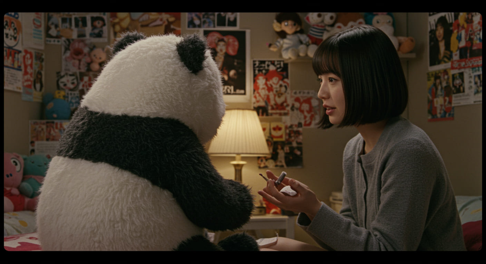</a>

👩　メイクしたら、あなたもっと可愛くなるわ。わたしにまかせて。

👩 With a little makeup, you’ll look even cuter. Trust me.

ENGLISH TIP

<strong class="term">trust me</strong> /trʌst mi/

私を信じて

<strong class="term">makeup</strong> /ˈmeɪkʌp/

化粧

<strong class="term">even cuter</strong> /ˈivən ˈkjutər/

さらにかわいく

</article>
<article class="work" id="2025-0919-01"><a href="#2025-0919-01">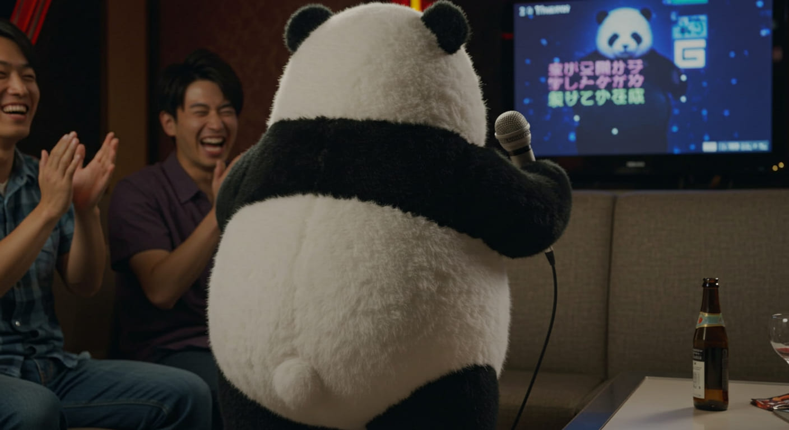</a>

🐼 改札に立ち尽くし…君を待ち続ける～ ♪

👨 よっ！

🐼 I stand at the ticket gate… still waiting for you ♪

👨 Hey!

ENGLISH TIP

<strong class="term">ticket gate</strong> /ˈtɪkɪt ɡeɪt/

改札口

<strong class="term">stand</strong> /stænd/

立つ

<strong class="term">wait for</strong> /weɪt fər/

～を待つ

</article>
<article class="work" id="2025-0913-01"><a href="#2025-0913-01">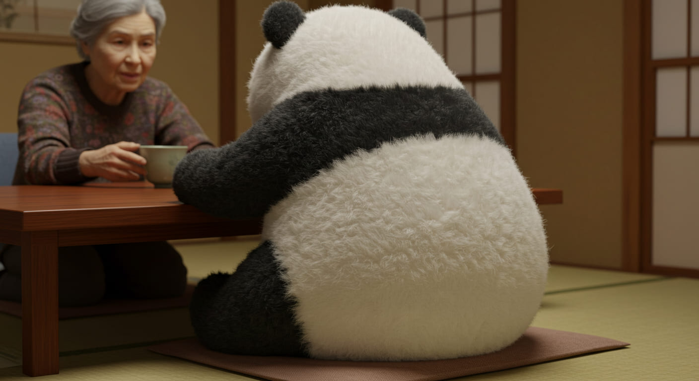</a>

👵　あんた、この家にすっかり懐いてるけど...

🐼　ただの野良パンダですよ。羊羹、おいしいです。

👵 You’ve really made yourself at home here…

🐼 I’m just a stray panda, that’s all. But this yokan is delicious.

ENGLISH TIP

<strong class="term">make yourself at home</strong> /meɪk jərˈself ət hoʊm/

くつろぐ

<strong class="term">stray</strong> /streɪ/

迷子の、野良の

<strong class="term">that's all</strong> /ðæts ɔl/

それだけ

</article>
<article class="work" id="2025-0912-01"><a href="#2025-0912-01">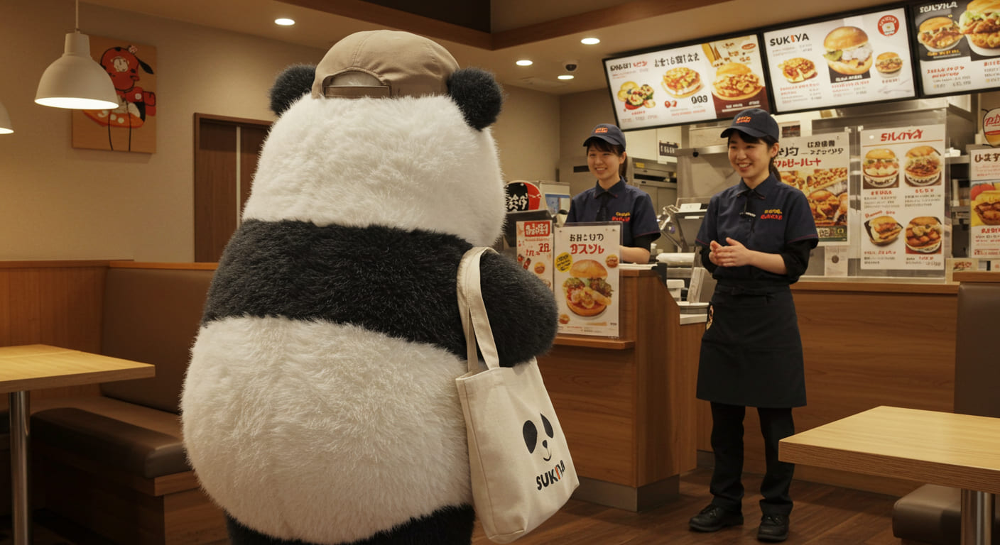</a>

🐼
タイミーから来ました！３時間だけですが、よろしくお願いします！

🐼
I’m from Timee. I’ll be working here for three hours, nice to meet you!

ENGLISH TIP

<strong class="term">nice to meet you</strong> /naɪs tə mit ju/

はじめまして

<strong class="term">work here</strong> /wɜrk hɪr/

ここで働く

<strong class="term">for three hours</strong> /fər θri ˈaʊərz/

3時間

</article>
<article class="work" id="2025-0911-01"><a href="#2025-0911-01">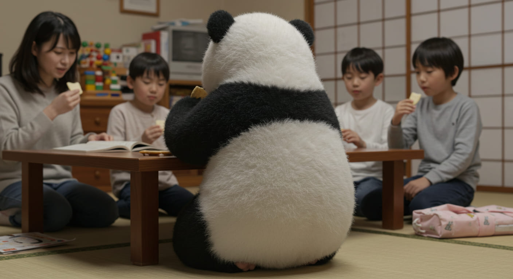</a>

🐼
お母さん、たけのこの里 買ってくれた？

👩
あれはチョコよ。たけのこ風味じゃないの。

🐼
Mom, did you get Bamboo Shoot Village?

👩
That’s chocolate. It doesn’t taste like bamboo shoots.

ENGLISH TIP

<strong class="term">taste like</strong> /teɪst laɪk/

～の味がする

<strong class="term">chocolate</strong> /ˈtʃɑklət/

チョコレート

<strong class="term">doesn't taste like</strong> /ˈdʌzənt teɪst laɪk/

～の味がしない

</article>
<article class="work" id="2025-0910-02"><a href="#2025-0910-02">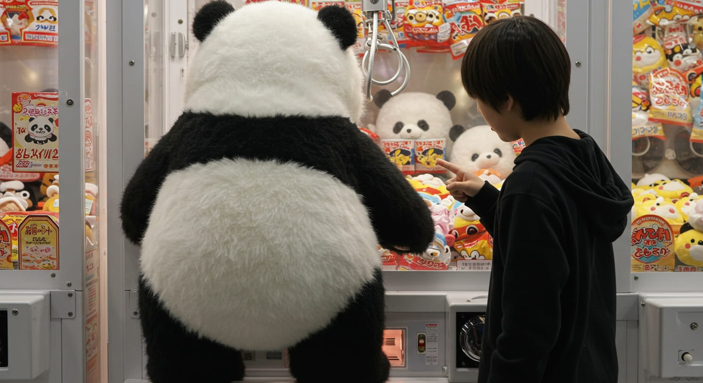</a>

🐼
あのパンダ、俺の方を見てる！

おい、500円くれ！

🐼
That panda’s staring at me! Hey, give me 500 yen!

ENGLISH TIP

<strong class="term">stare at</strong> /ster æt/

じっと見つめる

<strong class="term">give me</strong> /ɡɪv mi/

私に～をちょうだい

<strong class="term">staring</strong> /ˈsterɪŋ/

じっと見ている

</article>
<article class="work" id="2025-0910-01"><a href="#2025-0910-01">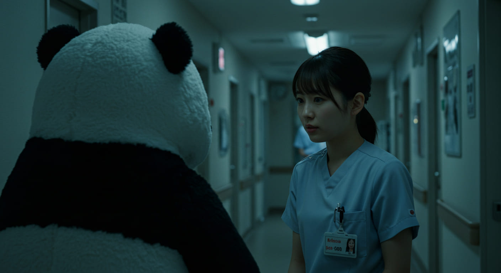</a>

🐼
ペンギンの容態は!?

👧
無理な鯖の丸呑みによる腸閉塞です。大丈夫です

🐼
How’s the penguin!?

👧
It swallowed a whole mackerel. Intestinal blockage, but it’ll be fine.

ENGLISH TIP

<strong class="term">swallow</strong> /ˈswɑloʊ/

飲み込む

<strong class="term">whole</strong> /hoʊl/

丸ごとの

<strong class="term">intestinal blockage</strong> /ɪnˈtestənəl ˈblɑkɪdʒ/

腸閉塞

</article>
<article class="work" id="2025-0909-01"><a href="#2025-0909-01">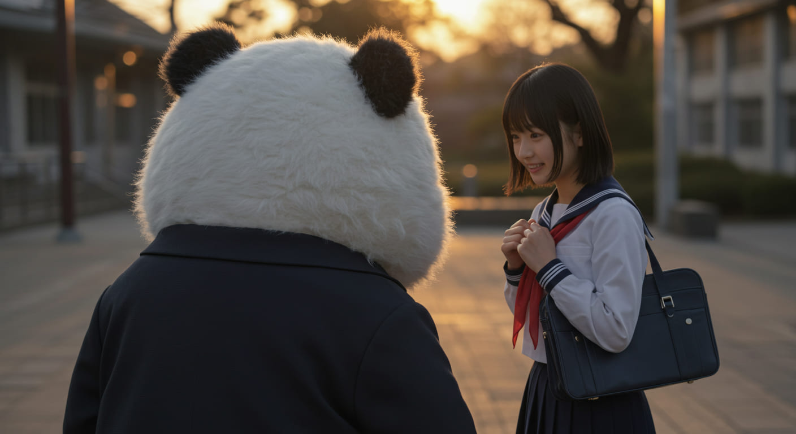</a>

👧
帰りさ、いっしょにタケノコ取りにいこ❤

🐼
うっせぇな。ひとりのほうがはかどるんだよ。服も汚れんだろ

👧
（...やさしい❤）

👧
On the way back, let’s go pick some bamboo shoots together. ❤

🐼
Geez… you’re better off not coming. Your clothes will just get dirty.

👧
(...he’s so kind ❤)

ENGLISH TIP

<strong class="term">better off</strong> /ˈbetər ɔf/

～した方がよい

<strong class="term">on the way back</strong> /ɑn ðə weɪ bæk/

帰り道に

<strong class="term">get dirty</strong> /ɡet ˈdɜrti/

汚れる

</article>
<article class="work" id="2025-0908-01"><a href="#2025-0908-01">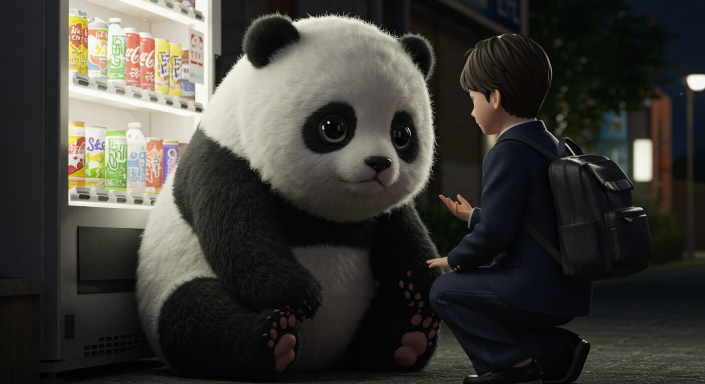</a>

👦
ごめんね。ジュース買えないから、どいてくれる？

🐼
君は知らないだろうけど、この自販機は僕の兄なんだ。

👦
Sorry… I can’t buy a drink. Could you move a little?

🐼
You don’t know this, but this vending machine is actually my brother.

ENGLISH TIP

<strong class="term">vending machine</strong> /ˈvendɪŋ məˈʃin/

自動販売機

<strong class="term">actually</strong> /ˈæktʃuəli/

実は

<strong class="term">Could you move?</strong> /kʊd ju muv/

動いていただけますか

</article>
<article class="work" id="2025-0907-02"><a href="#2025-0907-02">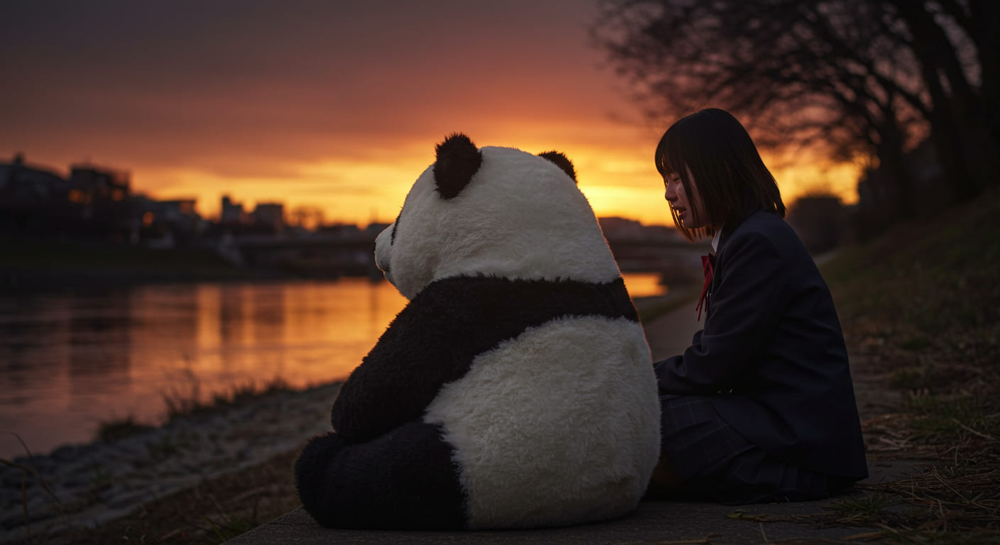</a>

👧
だから...あなたが好きだって..

🐼
僕が珍獣だからでしょ？ パンダだったら、誰でもいいんでしょ..

👧
Because… I really do love you.

🐼
No… you only love me because I’m rare. It could be any panda, right?

ENGLISH TIP

<strong class="term">rare</strong> /rer/

珍しい

<strong class="term">really do</strong> /ˈriəli du/

本当に～する（強調）

<strong class="term">any panda</strong> /ˈeni ˈpændə/

どのパンダでも

</article>
<article class="work" id="2025-0907-01"><a href="#2025-0907-01">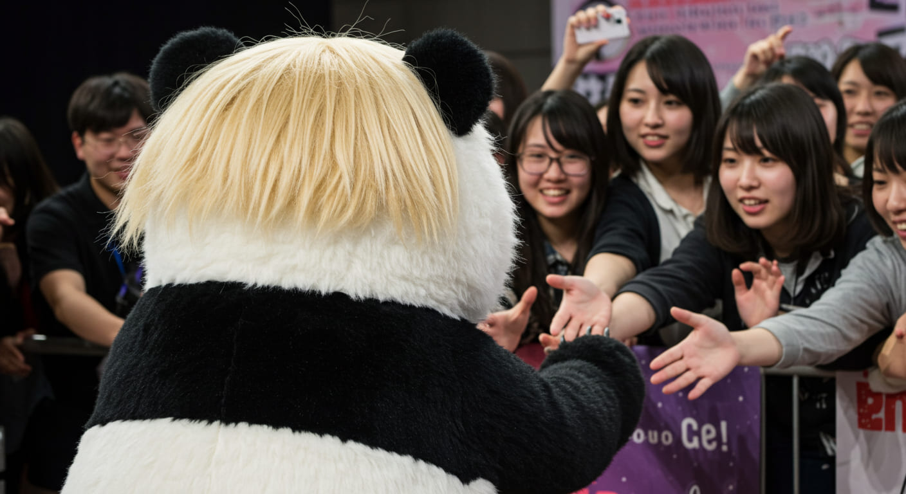</a>

👧
パンダちゃーん、握手してー！❤

🐼
はい順番ね、順番ねー。

👧 Panda-chan, shake my hand! ❤

🐼 Okay, one at a time, one at a time.

ENGLISH TIP

<strong class="term">one at a time</strong> /wʌn ət ə taɪm/

一人ずつ、一つずつ

<strong class="term">shake my hand</strong> /ʃeɪk maɪ hænd/

握手して

<strong class="term">okay</strong> /oʊˈkeɪ/

わかった

</article>
<article class="work" id="2025-0906-01"><a href="#2025-0906-01">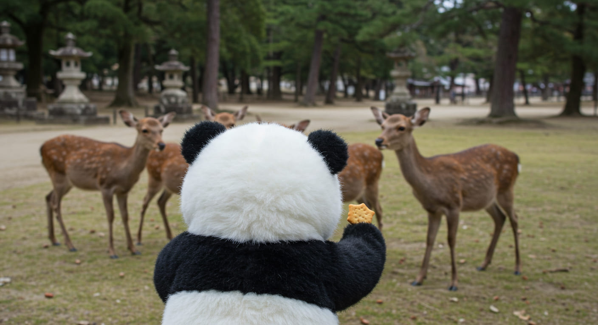</a>

🐼
実は...自分用に買ったビスコでした～！

🦌
角のある先輩、呼んでくる

🐼  Actually… I bought these biscuits for myself!

🦌  I’ll go call the senior with the antlers.

ENGLISH TIP

<strong class="term">antler</strong> /ˈæntlər/

鹿の枝角

<strong class="term">for myself</strong> /fər maɪˈself/

自分のために

<strong class="term">senior</strong> /ˈsinjər/

先輩

</article>
<article class="work" id="2025-0904-01"><a href="#2025-0904-01">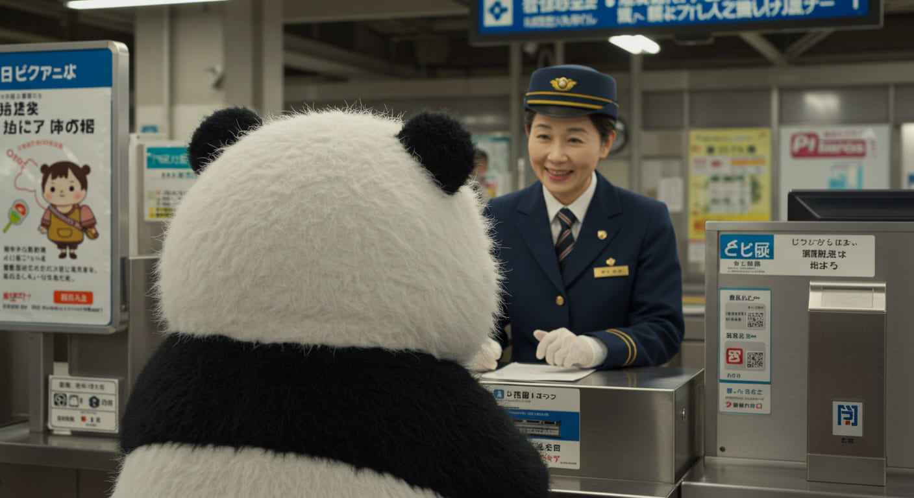</a>

👧
あら、かわいい... 迷子？

🐼
改札で、横腹が擦れるんですよ。

幅を広げてもらえませんか？

👧 Oh, how cute... Are you lost?

🐼 Could you widen the ticket gate a little? My belly keeps scraping the sides.

ENGLISH TIP

<strong class="term">scrape</strong> /skreɪp/

こする

<strong class="term">widen</strong> /ˈwaɪdən/

広げる

<strong class="term">belly</strong> /ˈbeli/

お腹

</article>
<article class="work" id="2025-0903-01"><a href="#2025-0903-01">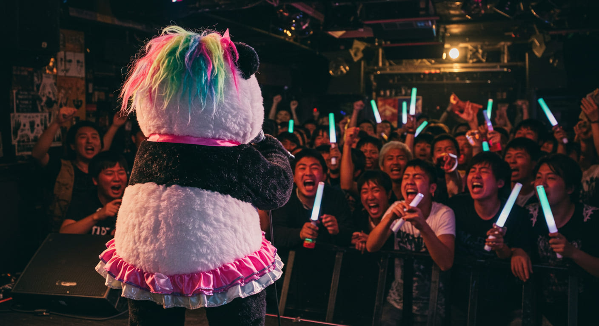</a>

🐼 はぁい♡ パンダちゃんだよ〜！みんな会いたかったぁ？

👨 会いたかったーー！！

🐼 Heeey! I’m Panda-chan! Did you miss meee?!

👨 YEEEESSSS!!!

ENGLISH TIP

<strong class="term">miss</strong> /mɪs/

会えなくて寂しく思う

<strong class="term">Did you miss me?</strong> /dɪd ju mɪs mi/

会いたかった？

<strong class="term">hey</strong> /heɪ/

やあ

</article>
<article class="work" id="2025-0902-02"><a href="#2025-0902-02">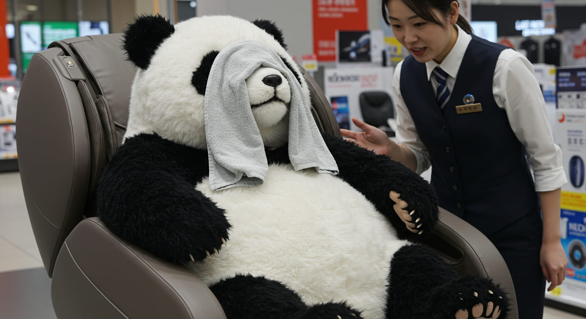</a>

👩　お客様... 毛の付着が気になっておりまして...

👩 Sir… we’re a bit concerned about all the fur you’re leaving behind…

ENGLISH TIP

<strong class="term">leave behind</strong> /liv bɪˈhaɪnd/

後に残す

<strong class="term">concerned about</strong> /kənˈsɜrnd əbaʊt/

～を心配して

<strong class="term">fur</strong> /fɜr/

動物の毛

</article>
<article class="work" id="2025-0902-01"><a href="#2025-0902-01">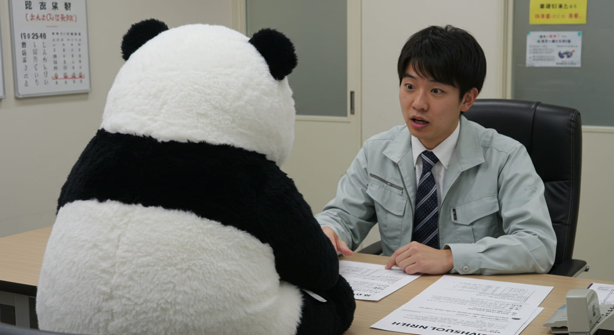</a>

👨　なんで片足をあげるんだ！？

👨  Why are you lifting one leg?!

ENGLISH TIP

<strong class="term">lift</strong> /lɪft/

持ち上げる

<strong class="term">leg</strong> /leɡ/

脚

<strong class="term">Why are you ～ing?</strong> /waɪ ər ju/

なぜ～しているの？

</article>
<article class="work" id="2025-0901-04"><a href="#2025-0901-04">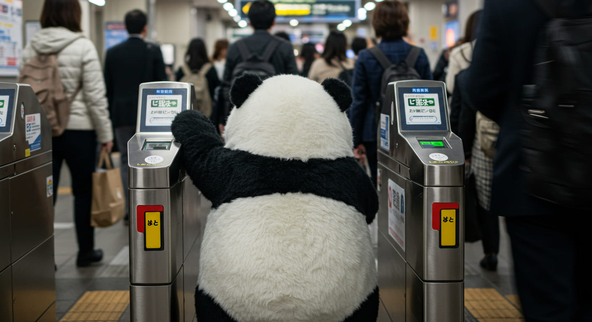</a>

月曜日は、上野動物園がお休み。

ぼくは、総武線で千葉に行って、落花生をひとつ食べます。

Monday is the day Ueno Zoo is closed.

I’m taking the Sobu Line to Chiba to eat just one peanut.

ENGLISH TIP

<strong class="term">take the line</strong> /teɪk ðə laɪn/

路線を利用する

<strong class="term">closed</strong> /kloʊzd/

閉まっている

<strong class="term">peanut</strong> /ˈpinʌt/

落花生

</article>
<article class="work" id="2025-0901-03">

🐼　同じのが２個つづいたんです。替えてくれませんか。

👧　それはできないんですよぅ

🐼 I got two of the same ones. Could you exchange one?

👧 Sorry, I’m afraid we can’t do that.

ENGLISH TIP

<strong class="term">exchange</strong> /ɪksˈtʃeɪndʒ/

交換する

<strong class="term">the same</strong> /ðə seɪm/

同じもの

<strong class="term">I'm afraid</strong> /aɪm əˈfreɪd/

申し訳ないが

</article>
<article class="work" id="2025-0901-01">

🐼　いま絶対カンチョーすんなよ、たぬき

🐼 Seriously, no kanchō right now, raccoon dog.

カンチョー：指でおしりを突く子どものいたずら

kanchō, a prank similar to giving a wedgie, but with fingers

ENGLISH TIP

<strong class="term">prank</strong> /præŋk/

いたずら

<strong class="term">similar to</strong> /ˈsɪmələr tu/

～に似た

<strong class="term">right now</strong> /raɪt naʊ/

今すぐ、今は

</article>
<article class="work" id="2025-0831-04">

桃屋のメンマ、切らしてたか...

Did I run out of Momoya’s seasoned menma…?

ENGLISH TIP

<strong class="term">run out of</strong> /rʌn aʊt əv/

～を使い切る

<strong class="term">seasoned</strong> /ˈsizənd/

味付けされた

<strong class="term">Did I ～?</strong> /dɪd aɪ/

私は～したのかな？

</article>
<article class="work" id="2025-0831-02">

👮　パンダ...か？

🐼　はい。上野動物園の非常勤です。

👮 Panda…?

🐼 Correct. Seasonal staff, Ueno Zoo.

ENGLISH TIP

<strong class="term">seasonal staff</strong> /ˈsizənəl stæf/

季節雇用の職員

<strong class="term">correct</strong> /kəˈrekt/

その通り

<strong class="term">staff</strong> /stæf/

職員

</article>
<article class="work" id="2025-0831-01">

🐼　はなしって、なによ？

👧　実はね、わたし昨日までハトだったの。まだパンくず拾おうとしちゃって..

🐼 What’s this talk about?

👧 Well… I was a pigeon until yesterday, so I still look for bread crumbs on the ground.

ENGLISH TIP

<strong class="term">bread crumbs</strong> /bred krʌmz/

パンくず

<strong class="term">until yesterday</strong> /ənˈtɪl ˈjestərdeɪ/

昨日まで

<strong class="term">look for</strong> /lʊk fər/

探す

</article>
<article class="work" id="2025-0830-05">

🦝 レッサーパンダって、パンダ以下って意味だろ？納得できない！

🐼 わかるよ... 僕とは全然似てないし...

🦝 モアパンダならな！ハハハ！

🐼 ...

🦝 Does ‘lesser panda’ mean I’m below panda? I can’t accept that!

🐼 I get it… we don’t even look alike…

🦝 Then call me ‘More Panda!’ Hahaha!

🐼 ...

ENGLISH TIP

<strong class="term">look alike</strong> /lʊk əˈlaɪk/

似ている

<strong class="term">accept</strong> /əkˈsept/

受け入れる

<strong class="term">lesser</strong> /ˈlesər/

より小さい、劣る

</article>
<article class="work" id="2025-0830-04">

👧 おはよう、パンダちゃん！

🐼 あ...おはようございます。

👧 何もってきたの？

👧 Good morning, Panda!

🐼 Ah… good morning.

👧 What did you bring with you?

ENGLISH TIP

<strong class="term">bring</strong> /brɪŋ/

持ってくる

<strong class="term">good morning</strong> /ɡʊd ˈmɔrnɪŋ/

おはよう

<strong class="term">What did you bring?</strong> /wʌt dɪd ju brɪŋ/

何を持ってきたの？

</article>
<article class="work" id="2025-0830-03">

👧 上野動物園前で降りるの？

🐼 あ... うん。

👧 どこから通ってるの？

👧 Do you get off at Ueno Zoo?

🐼 Uh... yeah.

👧 Which stop are you coming from?

ENGLISH TIP

<strong class="term">get off</strong> /ɡet ɔf/

乗り物から降りる

<strong class="term">stop</strong> /stɑp/

停留所

<strong class="term">come from</strong> /kʌm frəm/

～から来る

</article>
<article class="work" id="2025-0830-01">

🧔　毛... 目に入る...

🧔　Fur... it's getting in my eyes...

ENGLISH TIP

<strong class="term">fur</strong> /fɜr/

動物の毛

<strong class="term">get in</strong> /ɡet ɪn/

中に入る

<strong class="term">eyes</strong> /aɪz/

目

</article>
<article class="work" id="2025-0829-02">

👨　いいアジが入ってるよ！どう？

🐧　３匹くらい丸飲みしていい？試食で。

👨 Fresh mackerel today! How about it?

🐧 Can I swallow three whole ones? For tasting.

ENGLISH TIP

<strong class="term">mackerel</strong> /ˈmækərəl/

サバ

<strong class="term">fresh</strong> /freʃ/

新鮮な

<strong class="term">for tasting</strong> /fər ˈteɪstɪŋ/

試食のために

</article>
<article class="work" id="2025-0829-01">

🐼 動物は無料ですよね？　  
　  ペンギンは友達です。保護希望じゃありません。

🐧 イワシ余ってない？腹減ってて

🐼 Animals get in free, right?
The penguin’s my friend, not for rescue.

🐧 Got any spare sardines? I’m starving.

ENGLISH TIP

<strong class="term">spare</strong> /sper/

余分の

<strong class="term">get in free</strong> /ɡet ɪn fri/

無料で入る

<strong class="term">starving</strong> /ˈstɑrvɪŋ/

ひどく空腹な

</article>
<article class="work" id="2025-0828-02">

次は、終点、白浜... アドベンチャーワールドの最寄り駅でございます。

自然と動物たちの世界を、心ゆくまでお楽しみください..

Next stop, Shirahama, the final station.

Gateway to Adventure World—enjoy the wonders of nature and animals.

ENGLISH TIP

<strong class="term">gateway</strong> /ˈɡeɪtweɪ/

玄関口

<strong class="term">final station</strong> /ˈfaɪnəl ˈsteɪʃən/

終着駅

<strong class="term">wonder</strong> /ˈwʌndər/

驚くべきもの

</article>
<article class="work" id="2025-0827-01">

あんた、パンダやんか！
縁起もんやわ、握手しなさい！

Well look at ya—you’re a panda! 
That’s good luck right here, now gimme a handshake!

ENGLISH TIP

<strong class="term">handshake</strong> /ˈhændʃeɪk/

握手

<strong class="term">good luck</strong> /ɡʊd lʌk/

幸運

<strong class="term">gimme</strong> /ˈɡɪmi/

give me のくだけた形

</article>
<article class="work" id="2025-0826-04">

🧔　動物園の暮らしにも慣れたか？

🐼　椅子の下に落ちてるピーナッツ、食べてもいいですか？

🧔 Have you gotten used to life in the zoo?

🐼 Can I eat the peanuts that fell under the chair?

ENGLISH TIP

<strong class="term">get used to</strong> /ɡet just tu/

～に慣れる

<strong class="term">fall under</strong> /fɔl ˈʌndər/

～の下に落ちる

<strong class="term">life in the zoo</strong> /laɪf ɪn ðə zu/

動物園での生活

</article>
<article class="work" id="2025-0826-03">

もう帰りたい...

でも、あいつ🐧があんなに喜んでいる...

なんだろう..この気持ちは..

I just want to go home…

But seeing him so happy, I can’t look away.

What is this feeling inside me?

ENGLISH TIP

<strong class="term">look away</strong> /lʊk əˈweɪ/

目をそらす

<strong class="term">feeling</strong> /ˈfilɪŋ/

感情

<strong class="term">seeing him</strong> /ˈsiɪŋ hɪm/

彼を見て

</article>
<article class="work" id="2025-0826-02">

🐧　その奇妙なベストはどうした？

🐼　動物園のお客さんにもらった

🐧　処分するやつじゃ..

🐧 Where’d you get that strange vest?

🐼 A zoo visitor gave it to me.

🐧 Wasn’t that meant to be thrown away…?

ENGLISH TIP

<strong class="term">throw away</strong> /θroʊ əˈweɪ/

捨てる

<strong class="term">vest</strong> /vest/

ベスト

<strong class="term">be meant to</strong> /bi ment tu/

～することを意図される

</article>
<article class="work" id="2025-0825-04">

🐧 
パンダよ…俺達もここで終いか…。散り際ぐらい、粋にいこうぜ…

🐼 
👩❤ 動物園のゲートまで、このまま抱っこでお願いします

🐧 
Panda boss… this is our end. Let’s go down with style…

🐼 
👩❤ Just carry me to the zoo gate.

ENGLISH TIP

<strong class="term">with style</strong> /wɪð staɪl/

格好よく

<strong class="term">go down</strong> /ɡoʊ daʊn/

倒れる、敗れる

<strong class="term">carry</strong> /ˈkæri/

運ぶ

</article>
<article class="work" id="2025-0825-02">

🐧　ポリ公め... 数が いやがる

🐼　ぬいぐるみのふりで バレないだろ

🐧 Damn cops… there’s too many of them.

🐼 If we just pretend to be stuffed animals, they’ll never notice.

ENGLISH TIP

<strong class="term">pretend to be</strong> /prɪˈtend tə bi/

～のふりをする

<strong class="term">stuffed animal</strong> /stʌft ˈænəməl/

ぬいぐるみ

<strong class="term">notice</strong> /ˈnoʊtɪs/

気づく

</article>
<article class="work" id="2025-0825-01">

👩　ごめんね..

🐼　ここに長くは いられないんだ.. 追われてて..

🐧　ポリのサイレンが近づいている！

👩 Panda… I’m so sorry.

🐼 I can’t stay here long… I’m being chased.

🐧 The police sirens are getting closer!

ENGLISH TIP

<strong class="term">be chased</strong> /bi tʃeɪst/

追われる

<strong class="term">stay</strong> /steɪ/

とどまる

<strong class="term">get closer</strong> /ɡet ˈkloʊsər/

近づく

</article>
<article class="work" id="2025-0824-02">

🐼　盗んだバイクで、行き先は川越… ちょっと尾崎っぽいだろ？

🐧　俺は幼児のリュックサックじゃねーんだぞ！AIめ！

🐼 On a stolen bike, heading for Kawagoe… Feels a bit Ozaki, huh?

🐧 I’m not some toddler’s backpack, you AI fool!

ENGLISH TIP

<strong class="term">head for</strong> /hed fər/

～へ向かう

<strong class="term">stolen</strong> /ˈstoʊlən/

盗まれた

<strong class="term">toddler</strong> /ˈtɑdlər/

幼児

</article>
<article class="work" id="2025-0824-01">

📺️  上野動物園よりパンダが脱走..
　　御徒町方面に走り去ったという目撃情報もあり、警察は確認を..

👩　...あの子！

📺 Breaking News! Panda escaped Ueno Zoo… Seen with a penguin near Okachimachi!

👩 …Is that him!?

ENGLISH TIP

<strong class="term">breaking news</strong> /ˈbreɪkɪŋ nuz/

速報

<strong class="term">escape</strong> /ɪˈskeɪp/

逃げる

<strong class="term">seen with</strong> /sin wɪð/

～と一緒にいるところを目撃された

</article>
<article class="work" id="2025-0823-07">

🐧　泳げないやつは、自然淘汰されるんだ。

🐼　なんでプールに誘った？

🐧 If you can’t swim, nature takes you out.

🐼 So… why did you bring me here?

ENGLISH TIP

<strong class="term">take out</strong> /teɪk aʊt/

取り除く、倒す

<strong class="term">nature</strong> /ˈneɪtʃər/

自然

<strong class="term">swim</strong> /swɪm/

泳ぐ

</article>
<article class="work" id="2025-0823-06">

🐧　昼は動物園で、夜はUberEatsとは忙しいな

🐼　あぁ。お金が必要なんだ。

🐧　ポリ公に気をつけてな

🐧 Busy life, huh—zoo by day, UberEats by night.

🐼 Yeah. I need the money.

🐧 Watch out for the cops.

ENGLISH TIP

<strong class="term">watch out for</strong> /wɑtʃ aʊt fər/

～に気をつける

<strong class="term">by day</strong> /baɪ deɪ/

昼は

<strong class="term">by night</strong> /baɪ naɪt/

夜は

</article>
<article class="work" id="2025-0823-05">

🐧 パンダ…泣いてるのか？　川越の家が恋しいんだな..

🐼 ほっとけよ…ﾋｯｸ…

🐧 Panda... are you crying? Thinking about your family home back in Kawagoe?

🐼 Shut up... sniff...

ENGLISH TIP

<strong class="term">family home</strong> /ˈfæməli hoʊm/

実家

<strong class="term">think about</strong> /θɪŋk əbaʊt/

～について考える

<strong class="term">sniff</strong> /snɪf/

鼻をすする

</article>
<article class="work" id="2025-0823-03">

🐼　飛べないくせに鳥ヅラすんな！

🐧　AIの時代にモノクロってなんだよ！大人しく絶滅してろ！

🐼　...（こいつ強ぇ..）

🐼 Can’t fly, so quit acting like a bird!

🐧 Black-and-white in the age of AI? Just go extinct!

🐼 ...(…Ugh, he’s tough…)

ENGLISH TIP

<strong class="term">go extinct</strong> /ɡoʊ ɪkˈstɪŋkt/

絶滅する

<strong class="term">quit doing</strong> /kwɪt ˈduɪŋ/

～するのをやめる

<strong class="term">act like</strong> /ækt laɪk/

～のように振る舞う

</article>
<article class="work" id="2025-0823-02">

🐼　ふぅ...

🐧　積み込み、おつかれさま。

🐼 （こいつ、鮭食っただけじゃねぇか..）

🐼 Phew...

🐧 Good job loading it all up.

🐼 (This guy only ate the salmon...)

ENGLISH TIP

<strong class="term">load up</strong> /loʊd ʌp/

積み込む

<strong class="term">good job</strong> /ɡʊd dʒɑb/

よくやった

<strong class="term">salmon</strong> /ˈsæmən/

サケ（l は発音しない）

</article>
<article class="work" id="2025-0823-01">

🐼　鮭のヒモ、肩からズレてきた..

🐧　あとちょっとで竹林だから、そこで降ろしてお昼にしよう

🐼 The salmon’s slipping off my shoulder...

🐧 Almost at the bamboo grove—let’s eat there.

ENGLISH TIP

<strong class="term">slip off</strong> /slɪp ɔf/

滑り落ちる

<strong class="term">shoulder</strong> /ˈʃoʊldər/

肩

<strong class="term">almost at</strong> /ˈɔlmoʊst æt/

もうすぐ～に着く

</article>
<article class="work" id="2025-08-22-02">

🐼　竹、食べ放題かと思ってたら 伐採を命じられるとはな..

🐧　茨城って、遠いな

🐼 Thought it was bamboo buffet… turns out it’s logging duty.

🐧 Ibaraki’s a long ride…

ENGLISH TIP

<strong class="term">turn out</strong> /tɜrn aʊt/

～だと判明する

<strong class="term">buffet</strong> /bəˈfeɪ/

食べ放題

<strong class="term">logging</strong> /ˈlɔɡɪŋ/

伐採

</article>
<article class="work" id="2025-0822-01">

このニューバランス、ひとつ上のサイズも出してもらえますか？ちょっときつくて..

Could I try these New Balance in the next size up? They feel a little tight.

ENGLISH TIP

<strong class="term">size up</strong> /saɪz ʌp/

ここでは一つ上のサイズを指す

<strong class="term">try on</strong> /traɪ ɑn/

試着する（関連表現）

<strong class="term">tight</strong> /taɪt/

きつい

</article>
<article class="work" id="2025-0821-09">

🐼 君が四角いうんちで有名なウォンバットくん？

🦔 ちがう。僕がうんちで、ウォンバットが僕を出してるんだ。

🐼 ……え？

🐼 Are you the wombat who’s famous for square poop?

🦔 No. I am the poop — the wombat is just the one who produced me.

🐼 …What?

ENGLISH TIP

<strong class="term">produce</strong> /prəˈdus/

生み出す

<strong class="term">be famous for</strong> /bi ˈfeɪməs fər/

～で有名だ

<strong class="term">square</strong> /skwer/

四角い

</article>
<article class="work" id="2025-0821-07">

🐧　牛丼食ってくか？おごるぜ

🐼　あざっす！吉野家あるんですね！すごいなぁ..上野動物園

🐧 How about beef bowls? It’s on me.

🐼 Thanks! Can’t believe there’s a Yoshinoya here… Ueno Zoo is amazing.

ENGLISH TIP

<strong class="term">It's on me</strong> /ɪts ɑn mi/

私のおごりです

<strong class="term">How about ～?</strong> /haʊ əˈbaʊt/

～はどう？

<strong class="term">can't believe</strong> /kænt bɪˈliv/

信じられない

</article>
<article class="work" id="2025-0821-06">

🦁　慣れたか？ここは飯はうまいぞ。都の税収があるからな。

🐼　あ、はい... ライオンさんはいつから？

🦁　...

🐧　パンダ、余計なことは聞くな

🦁 Getting used to it? The food’s good here—city taxes pay for it.

🐼 Oh… since when, Mr. Lion?

🦁 …

🐧 Panda, don’t ask too much.

ENGLISH TIP

<strong class="term">since when</strong> /sɪns wen/

いつから

<strong class="term">city taxes</strong> /ˈsɪti ˈtæksɪz/

市税

<strong class="term">pay for</strong> /peɪ fər/

～の費用を負担する

</article>
<article class="work" id="2025-0821-05">

🐷　新入りブー？俺はナポレオンだブー

🐼　その姿は..あの動物農場の！

🐷　ブー。俺に逆らわない方がいいブー

🐼　...（緊張）

🐷 New here, oink? I’m Napoleon.

🐼 What—like in Animal Farm?!

🐷 That’s right. Best not cross me, oink.

ENGLISH TIP

<strong class="term">cross</strong> /krɔs/

逆らう

<strong class="term">new here</strong> /nu hɪr/

ここに来たばかり

<strong class="term">best not</strong> /best nɑt/

～しない方がよい

</article>
<article class="work" id="2025-0821-04">

📺️ 本日より上野動物園では、正体不明のパンダが現れ、来園者を喜ばせています…

👩 ごめんね..もっと収入があったら..まだ一緒にいられたのに。

📺️ Starting today, an unknown panda has appeared at Ueno Zoo, delighting visitors…

👩 I’m sorry… if I’d earned more, we could still be together.

ENGLISH TIP

<strong class="term">delight</strong> /dɪˈlaɪt/

喜ばせる

<strong class="term">unknown</strong> /ʌnˈnoʊn/

正体不明の

<strong class="term">earn</strong> /ɜrn/

稼ぐ

</article>
<article class="work" id="2025-0821-03">

🦤 …………（じーっ）

🐼　あの.. ぼく魚たべないんで...どうぞ...

🦤 ………… (stares)

🐼 Uh… I don’t eat fish, so… please, go ahead…

ENGLISH TIP

<strong class="term">go ahead</strong> /ɡoʊ əˈhed/

どうぞ

<strong class="term">stare</strong> /ster/

じっと見る

<strong class="term">I don't eat ～</strong> /aɪ doʊnt it/

私は～を食べない

</article>
<article class="work" id="2025-0821-1">

🐧
俺と同室だ。室温は常に10℃。

🐼
…はい。（パンダにしちゃ&quot;冷遇&quot;されてない？？）

🐧
Room with me. Always 10°C.

🐼 
…Right. (Cold deal for a panda…)

ENGLISH TIP

<strong class="term">deal</strong> /dil/

取引、扱い

<strong class="term">room with</strong> /rum wɪð/

～と同室になる

<strong class="term">cold</strong> /koʊld/

寒い、冷たい

</article>
<article class="work" id="2025-08-20-13">

👨 今日から入園するパンダ君だ。みんな、仲良くな。

🐼 よろしくお願いします！
（…おい園長、前列ライオン率高すぎだろ！キリンも！）

👨 This panda joins us today. Be friendly.

🐼 Nice to meet you! 
(…Front row’s all lions… and giraffes!)

ENGLISH TIP

<strong class="term">front row</strong> /frʌnt roʊ/

最前列

<strong class="term">join</strong> /dʒɔɪn/

加わる

<strong class="term">friendly</strong> /ˈfrendli/

親しみやすい

</article>
<article class="work" id="2025-0820-12">

🐼 それじゃ、しばらく上野にいってきます

👦 すぐ戻るよね！？

👩 戻るわ、心配しないで

🐼 My path takes me to Ueno for some time.

👦 You’ll come back… right?

👩 He will. The panda always finds his way home.

ENGLISH TIP

<strong class="term">find one's way home</strong> /faɪnd wʌnz weɪ hoʊm/

家に帰る道を見つける

<strong class="term">for some time</strong> /fər sʌm taɪm/

しばらくの間

<strong class="term">come back</strong> /kʌm bæk/

戻ってくる

</article>
<article class="work" id="2025-0820-11">

👵
あら、どこかで見たことあるわねぇ..

🐼
きっとNHKの自然番組です。再放送によく出ますので。

👵
Oh my, I feel like I’ve seen you somewhere before...

🐼
Probably on an NHK nature program. I show up a lot in the reruns.

ENGLISH TIP

<strong class="term">rerun</strong> /ˈriˌrʌn/

再放送

<strong class="term">feel like</strong> /fil laɪk/

～という気がする

<strong class="term">show up</strong> /ʃoʊ ʌp/

現れる

</article>
<article class="work" id="2025-0820-10">

🐼
リモコン、君がお尻で踏んでる

👧
えっ、じゃあ今テレビはお尻が操作してるってこと？

🐼 
The remote… you’re sitting on it.

👧
Wait, so my butt is running the TV right now?

ENGLISH TIP

<strong class="term">remote</strong> /rɪˈmoʊt/

リモコン

<strong class="term">sit on</strong> /sɪt ɑn/

～の上に座る

<strong class="term">butt</strong> /bʌt/

お尻（くだけた語）

</article>
<article class="work" id="2025-0820-08">

🐼 見ろ、お尻から滑れるぜ！

👦 ママに怒られるよ..

🐼 Look, I can slide down on my butt!

👦 Careful… Mom won’t like it.

ENGLISH TIP

<strong class="term">slide down</strong> /slaɪd daʊn/

滑り降りる

<strong class="term">careful</strong> /ˈkerfəl/

気をつけて

<strong class="term">on my butt</strong> /ɑn maɪ bʌt/

お尻をついて

</article>
<article class="work" id="2025-0820-07">

🐼
宿題まだ終わんないの？

👦
パンダが見てたら集中できないよ

🐼
Still not done with your homework?

👦
I can’t focus with a panda watching me.

ENGLISH TIP

<strong class="term">focus</strong> /ˈfoʊkəs/

集中する

<strong class="term">homework</strong> /ˈhoʊmwɜrk/

宿題

<strong class="term">be done with</strong> /bi dʌn wɪð/

～を終えている

</article>
<article class="work" id="2025-0820-06">

👩
物価が上がってたいへんなのよ.. あなたの竹だってねぇ..

🐼
上野は家賃高いけど.. 社宅付きなら考えるよ

👩
The cost of living keeps going up… even your bamboo, you know.

🐼
Rent in Ueno is high… but if it comes with free housing, I’m in.

ENGLISH TIP

<strong class="term">cost of living</strong> /kɔst əv ˈlɪvɪŋ/

生活費

<strong class="term">keep going up</strong> /kip ˈɡoʊɪŋ ʌp/

上がり続ける

<strong class="term">free housing</strong> /fri ˈhaʊzɪŋ/

無料の住居

</article>
<article class="work" id="2025-0820-05">

🦁 
なんでここに来た？

🐼
ライオンが誘う夜は断れません。

🦁
Why did you come here?

🐼
If a lion calls me at night, how could I refuse?

ENGLISH TIP

<strong class="term">refuse</strong> /rɪˈfjuz/

断る

<strong class="term">how could I ～?</strong> /haʊ kʊd aɪ/

どうして～できようか

<strong class="term">call</strong> /kɔl/

呼ぶ、電話する

</article>
<article class="work" id="2025-0820-1">

👦 
植物に詳しいんだね。先生、驚いてた

🐼
僕にとっては半分ご飯だからね

👦
You really know plants. Our teacher was amazed.

🐼
For me, they’re mostly food.

ENGLISH TIP

<strong class="term">amazed</strong> /əˈmeɪzd/

驚いた

<strong class="term">mostly</strong> /ˈmoʊstli/

主に

<strong class="term">plant</strong> /plænt/

植物

</article>
<article class="work" id="2025-0820-2">

おい、にんじん。ちょっとオレンジ主張しすぎじゃない？

Hey, carrot… don’t you think you’re showing off that orange a bit too much?

ENGLISH TIP

<strong class="term">show off</strong> /ʃoʊ ɔf/

見せびらかす

<strong class="term">carrot</strong> /ˈkærət/

ニンジン

<strong class="term">a bit too much</strong> /ə bɪt tu mʌtʃ/

少し度が過ぎる

</article>
<article class="work" id="2025-0819-5">

笹のスムージーをグランデでお願いしたいんですが。

May I have a bamboo leaf smoothie in a grande size, please?

ENGLISH TIP

<strong class="term">May I have</strong> /meɪ aɪ hæv/

～をいただけますか

<strong class="term">smoothie</strong> /ˈsmuði/

スムージー

<strong class="term">size</strong> /saɪz/

サイズ

</article>
<article class="work" id="2025-0819-4">

👩
フレンチって特別感あるわよね

🐼
はい、特別に少ないです

👩
French cuisine really feels special, doesn’t it?

🐼
Yes… especially small.

ENGLISH TIP

<strong class="term">especially</strong> /ɪˈspeʃəli/

特に

<strong class="term">cuisine</strong> /kwɪˈzin/

料理、料理様式

<strong class="term">special</strong> /ˈspeʃəl/

特別な

</article>
<article class="work" id="2025-0819-3">

肉球、認証しない...

Apple won’t recognize my paw pad…

ENGLISH TIP

<strong class="term">recognize</strong> /ˈrekəɡnaɪz/

認識する

<strong class="term">paw pad</strong> /pɔ pæd/

肉球

<strong class="term">won't</strong> /woʊnt/

will not の短縮形

</article>
<article class="work" id="2025-0819-2">

👩
ちょっと.. 狭いって..パンダ！

🐼
先にタケノコとらせてよ

👦
パンダ、よくたべるねぇ

👨
わたしの分だぞ..

👩
Move over a bit, Panda!

🐼
Let me pick up the bamboo shoots first.

👦
Panda, you sure eat a lot!

👨
That’s my share, you know…

ENGLISH TIP

<strong class="term">move over</strong> /muv ˈoʊvər/

少し横にずれる

<strong class="term">pick up</strong> /pɪk ʌp/

拾う、取る

<strong class="term">share</strong> /ʃer/

取り分

</article>
<article class="work" id="2025-08-19">

🐼
コストコ...きょうはずっと試食だぞ！

🦝
だね！年会費を1日で取り返そう！

🐼 
Costco... today we’ll eat samples all day!

🦝
Yeah! We’ll get back the membership with our tummies!

ENGLISH TIP

<strong class="term">membership</strong> /ˈmembərʃɪp/

会員資格

<strong class="term">sample</strong> /ˈsæmpəl/

試食品

<strong class="term">get back</strong> /ɡet bæk/

取り戻す

</article>
<article class="work" id="2025-08-18-5">

🐼 上野動物園までお願いします

🧔 え、こんな時間からですか？

🐼 えぇ。ナイトズー ってやつです。夜勤ですよ

🐼 To Ueno Zoo, please.

🧔 At this hour?

🐼 Yes. The Night Zoo doesn’t work without me.

ENGLISH TIP

<strong class="term">at this hour</strong> /ət ðɪs ˈaʊər/

こんな時間に

<strong class="term">without</strong> /wɪˈðaʊt/

～なしで

<strong class="term">work</strong> /wɜrk/

機能する

</article>
<article class="work" id="2025-08-18-4">

🐼
先生、最近どうも眠くて…

👨‍⚕️
パンダだからでしょうね

🐼
Doctor, I’ve been feeling really sleepy lately…

👨‍⚕️
That’s because you’re a panda.

ENGLISH TIP

<strong class="term">lately</strong> /ˈleɪtli/

最近

<strong class="term">sleepy</strong> /ˈslipi/

眠い

<strong class="term">I've been feeling</strong> /aɪv bɪn ˈfilɪŋ/

最近ずっと～と感じている

</article>
<article class="work" id="2025-08-18-2">

波動拳出ない。毛が邪魔してる

Can't pull off a Hadoken — my fur's in the way

ENGLISH TIP

<strong class="term">pull off</strong> /pʊl ɔf/

難しいことをやり遂げる

<strong class="term">in the way</strong> /ɪn ðə weɪ/

邪魔になって

<strong class="term">fur</strong> /fɜr/

動物の毛

</article>
<article class="work" id="2025-08-18">

🐼
すみません、このキャベツ、笹の味はしますか？

👨
しないねぇ.. どこをどう食べてもキャベツだねぇ

🐼
Excuse me, does this cabbage taste like bamboo leaves?

👨
No… it will only ever taste like cabbage.

ENGLISH TIP

<strong class="term">ever</strong> /ˈevər/

いつであっても

<strong class="term">cabbage</strong> /ˈkæbɪdʒ/

キャベツ

<strong class="term">taste like</strong> /teɪst laɪk/

～の味がする

</article>
<article class="work" id="panda-20250817-3">

🐰
あなた、そろそろ出稼ぎにいってもらわないと..

🐼
あぁ、わかってる。上野動物園が日給いいらしいんだ

🐰
You know… it’s about time you went out to make some money.

🐼
Yeah, I know. They say Ueno Zoo pays pretty well per day.

ENGLISH TIP

<strong class="term">it's about time</strong> /ɪts əˈbaʊt taɪm/

そろそろ～すべき時だ

<strong class="term">make money</strong> /meɪk ˈmʌni/

お金を稼ぐ

<strong class="term">per day</strong> /pər deɪ/

1日あたり

</article>
<article class="work" id="panda-20250817-2">

🧔
何にします？

🐼
若竹煮と... たけのこの土佐煮、あとメンマももらおうかな

🧔
What’ll you have?

🐼
Hmm… the bamboo with wakame, the braised bamboo shoots… and yeah, throw in some menma too.

ENGLISH TIP

<strong class="term">throw in</strong> /θroʊ ɪn/

追加する

<strong class="term">braised</strong> /breɪzd/

煮込んだ

<strong class="term">What'll you have?</strong> /wʌtəl ju hæv/

何にしますか？

</article>
<article class="work" id="panda-20250817">

🐼
パンダに最低賃金が適用されないって、どういうことですか！？　ずっと楽しみにしてたのに！

🐼
What do you mean pandas don’t get minimum wage!? I’d been looking forward to this!

minimum wage
最低賃金
[ˈmɪnɪməm weɪdʒ]

ENGLISH TIP

<strong class="term">minimum wage</strong> /ˈmɪnɪməm weɪdʒ/

最低賃金

<strong class="term">look forward to</strong> /lʊk ˈfɔrwərd tu/

～を楽しみにする

<strong class="term">What do you mean?</strong> /wʌt du ju min/

どういう意味ですか？

</article>
<article class="work" id="2025-08-18-3">

俺はクマだ... 俺はクマだ... 
いける、いけるぞ

I’m a bear… I’m a bear…
I can do this. I can do this!

ENGLISH TIP

<strong class="term">I can do this</strong> /aɪ kən du ðɪs/

自分ならできる

<strong class="term">bear</strong> /ber/

クマ

<strong class="term">can</strong> /kæn/

～できる

</article>

</main></body></html>
