## パンダの英語川柳

*Gentle English Haiku Inspired by a Plush Panda*

  <a class="image-link" href="/senryu/works/panda-sleeping-woman-fireplace-snowy-night/" aria-label="作品を個別表示">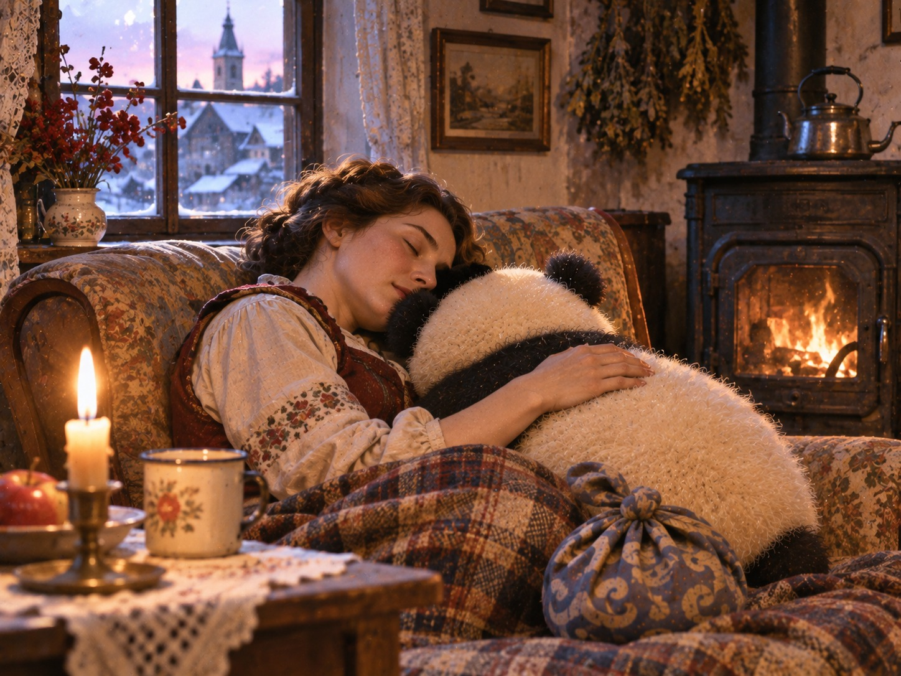</a>
  

雪の夜
言葉はいらぬ
腕の中
A snowy night,
no words are needed
in your arms.
  

  

ENGLISH TIP
<ul><li>snowy night：雪の降る夜。</li><li>no words are needed：言葉はいらない。受動態を使った表現。</li><li>in your arms：あなたの腕の中で。安心感や親愛の情を表す。</li></ul>

  
<a href="/senryu/works/panda-sleeping-woman-fireplace-snowy-night/" aria-label="作品を個別表示" title="個別ページ">↗</a>

  <a class="image-link" href="/senryu/works/panda-reading-picture-book-rainy-japanese-bookshop/" aria-label="作品を個別表示">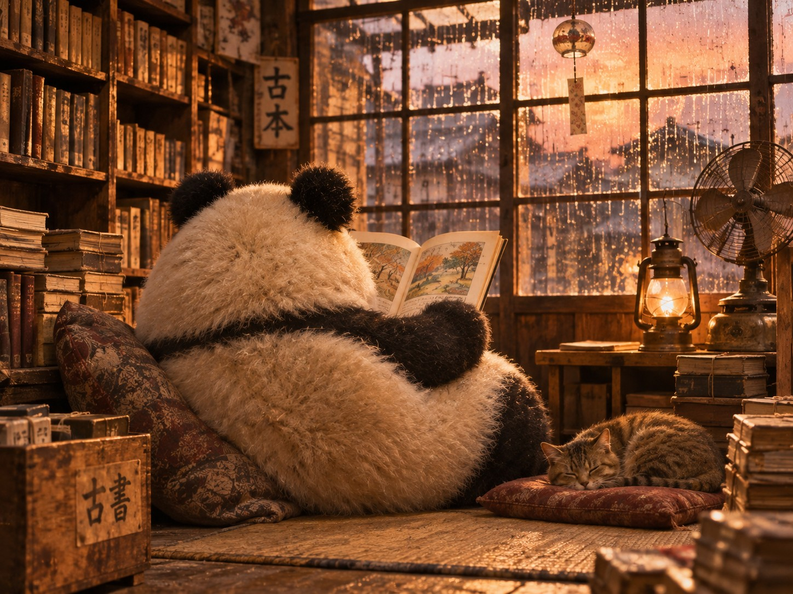</a>
  

雨上がり
まだ帰らない
物語
The rain has stopped,
but the story
keeps me here.
  

  

ENGLISH TIP
<ul><li>The rain has stopped.：雨がやんだ。現在完了形で現在の状況を表す。</li><li>keep me here：私をここに引き留める。keep＋人＋場所の表現。</li></ul>

  
<a href="/senryu/works/panda-reading-picture-book-rainy-japanese-bookshop/" aria-label="作品を個別表示" title="個別ページ">↗</a>

  <a class="image-link" href="/senryu/works/2026-1118-0/" aria-label="作品を個別表示">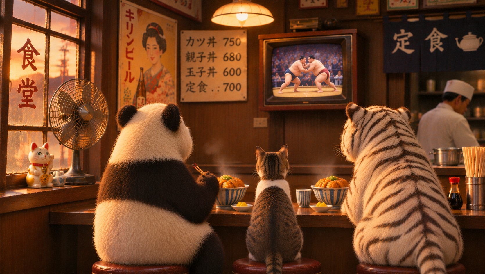</a>
  

大相撲
見つめるパンダ
腹を撫で
Grand sumo on TV,
The panda watches closely,
Patting his round belly.
  

  

ENGLISH TIP
<ul><li>watch closely：じっと見つめる。closely は注意深く、の意味。</li><li>pat one's belly：お腹を軽くたたく、なでる。Patting は同時進行の動作を表す。</li></ul>

  
<a href="/senryu/works/2026-1118-0/" aria-label="作品を個別表示" title="個別ページ">↗</a>

  <a class="image-link" href="/senryu/works/2026-0425-0/" aria-label="作品を個別表示">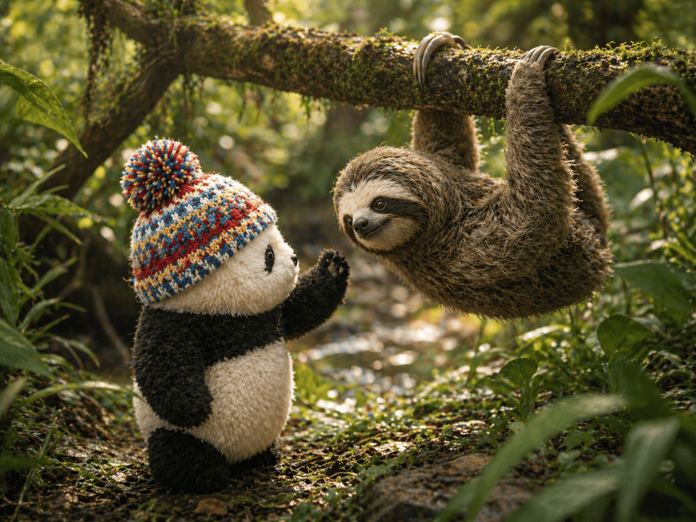</a>
  

森深く
急がぬ者の
正しさよ
Deep in the forest,
those who do not hurry
feel most in tune. 
  

  

ENGLISH TIP
<ul><li>deep in the forest：森の奥深くで。</li><li>those who ...：〜する人々。in tune は調和している、という意味。</li></ul>

  
<a href="/senryu/works/2026-0425-0/" aria-label="作品を個別表示" title="個別ページ">↗</a>

  
  

夕日追う
パンダと子ども
駆けてゆく 
Chasing the sunset—
panda and child
running down the beach
  

  

ENGLISH TIP
<ul><li>chase the sunset：夕日を追いかける。</li><li>run down the beach：浜辺に沿って走る。詩では主語の冠詞や動詞の一部を省くことがある。</li></ul>

  
<a href="/senryu/works/2026-0314-2/" aria-label="作品を個別表示" title="個別ページ">↗</a>

  <a class="image-link" href="/senryu/works/2026-0227-0/" aria-label="作品を個別表示">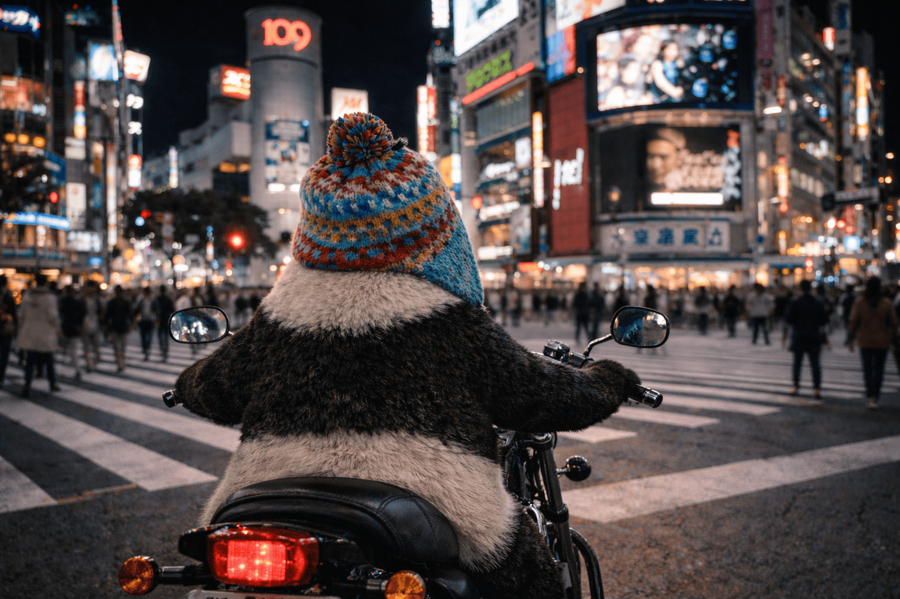</a>
  

渋谷夜
ネオンの波に
毛並み揺れ
Tokyo night—
in neon waves
fur sways
  

  

ENGLISH TIP
<ul><li>neon waves：ネオンの波（街の光を波にたとえた表現）。</li><li>fur：動物の毛。sway はゆらゆら揺れる。</li></ul>

  
<a href="/senryu/works/2026-0227-0/" aria-label="作品を個別表示" title="個別ページ">↗</a>

  <a class="image-link" href="/senryu/works/2026-0225-1/" aria-label="作品を個別表示">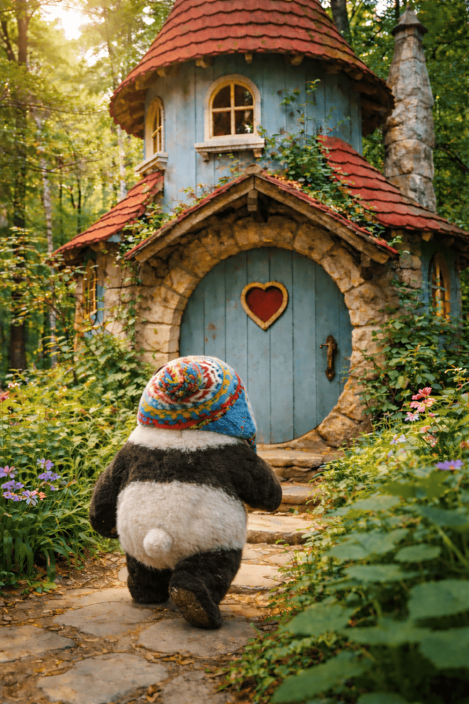</a>
  

森しんと
友を思ひて
足取り軽く
Forest stillness.
Thinking of my friend,
my steps feel light.
  

  

ENGLISH TIP
<ul><li>stillness：静けさ。still から派生した名詞。</li><li>think of：〜を思う。my steps feel light は足取りが軽いという表現。</li></ul>

  
<a href="/senryu/works/2026-0225-1/" aria-label="作品を個別表示" title="個別ページ">↗</a>

  <a class="image-link" href="/senryu/works/2026-0225-0/" aria-label="作品を個別表示">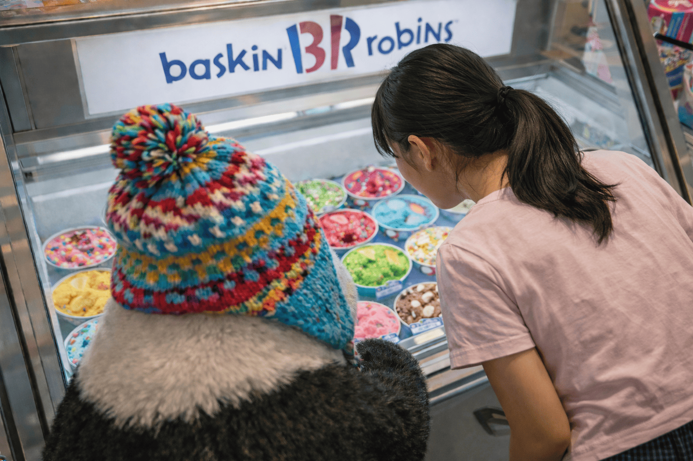</a>
  

ケース越し
世界は甘く
静まりぬ
Through the glass,
the world turns sweet
and goes quiet.
  

  

ENGLISH TIP
<ul><li>through the glass：ガラス越しに。</li><li>turn sweet / go quiet：甘くなる／静かになる。turn と go は状態の変化を示す。</li></ul>

  
<a href="/senryu/works/2026-0225-0/" aria-label="作品を個別表示" title="個別ページ">↗</a>

  <a class="image-link" href="/senryu/works/2026-0219-0/" aria-label="作品を個別表示">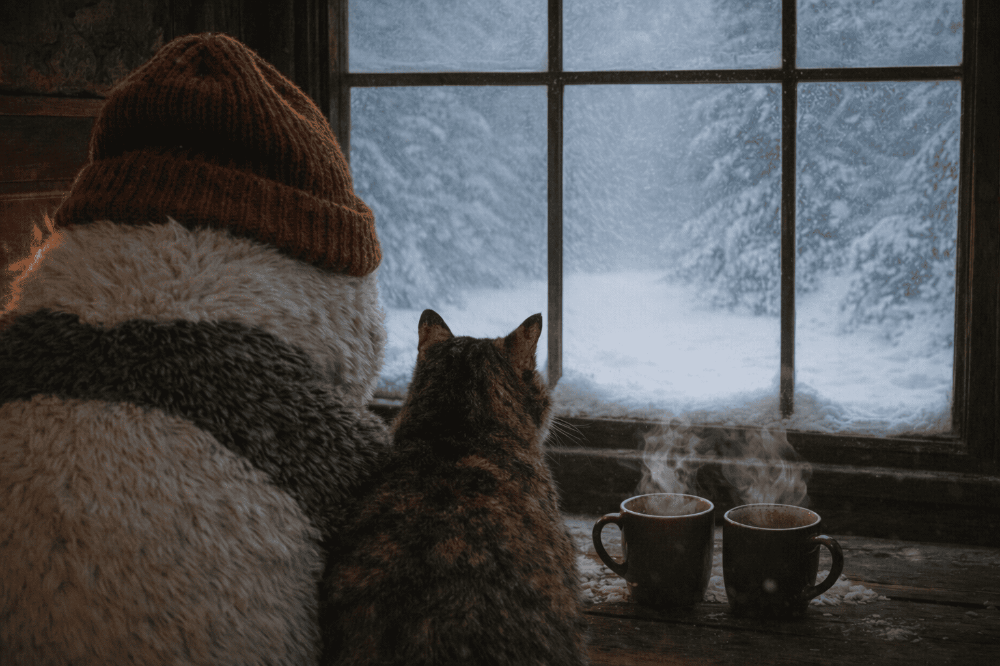</a>
  

吹雪見つ
猫と肩寄せ
パンダ照れ
Snow blowing hard
shoulder to shoulder with a cat—
the panda blushes
  

  

ENGLISH TIP
<ul><li>blow hard：激しく吹く。</li><li>shoulder to shoulder：肩を並べて。blush は照れて赤面する。</li></ul>

  
<a href="/senryu/works/2026-0219-0/" aria-label="作品を個別表示" title="個別ページ">↗</a>

  <a class="image-link" href="/senryu/works/2026-0218-0/" aria-label="作品を個別表示">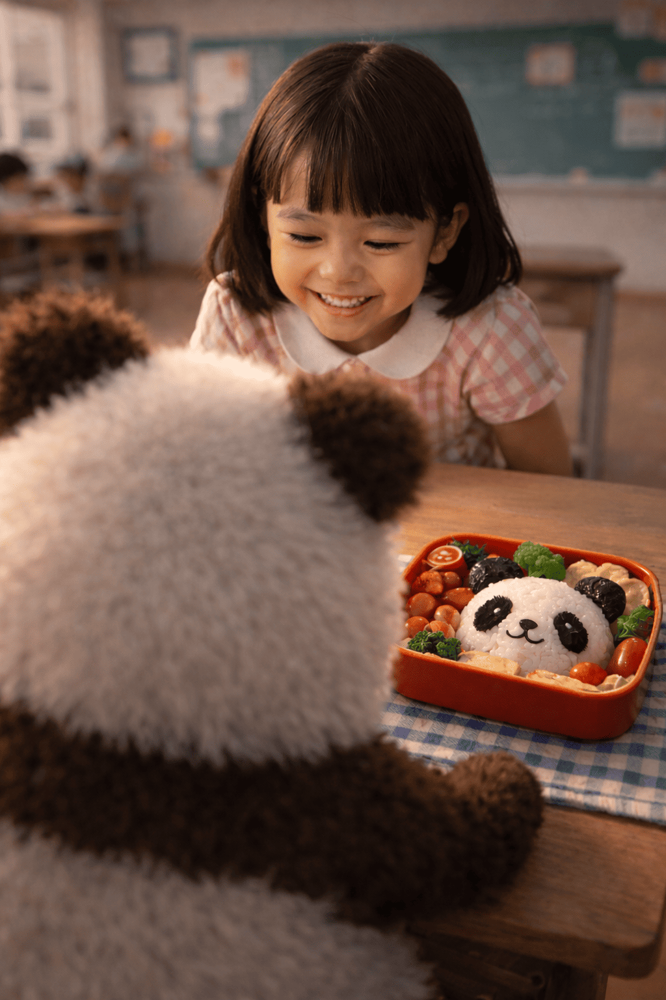</a>
  

見てるだけ
食べる前から
うれしいね
Just looking—
already happy
before eating.
  

  

ENGLISH TIP
<ul><li>just looking：見ているだけ。</li><li>already：すでに。before eating は食べる前に、という意味。</li></ul>

  
<a href="/senryu/works/2026-0218-0/" aria-label="作品を個別表示" title="個別ページ">↗</a>

  <a class="image-link" href="/senryu/works/2026-0216-0/" aria-label="作品を個別表示">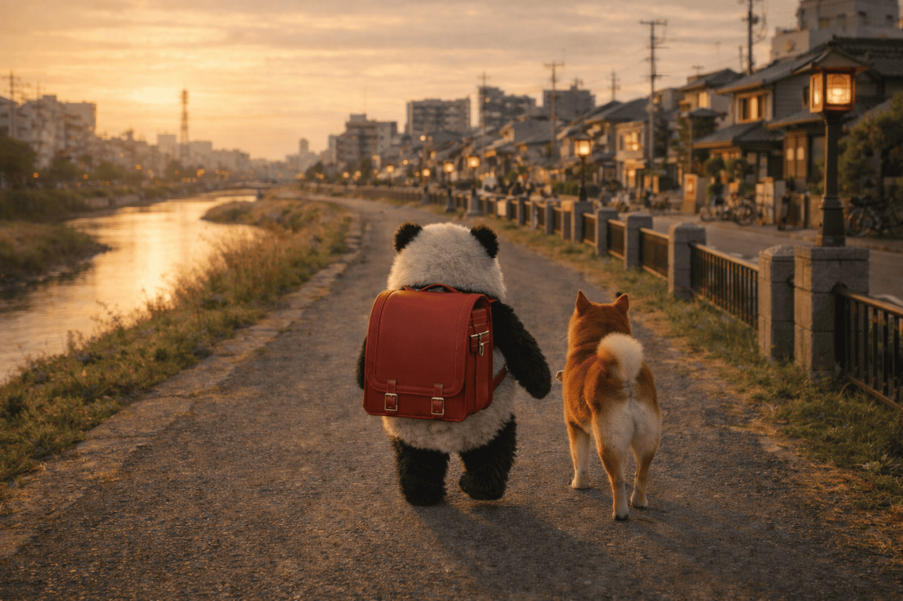</a>
  

暮れ空に
話し足りない
背中かな
Dusk overhead,
words not quite enough,
only their backs.
  

  

ENGLISH TIP
<ul><li>dusk：夕暮れ。overhead は頭上に。</li><li>not quite enough：十分とは言えない。backs は後ろ姿を表す。</li></ul>

  
<a href="/senryu/works/2026-0216-0/" aria-label="作品を個別表示" title="個別ページ">↗</a>

  <a class="image-link" href="/senryu/works/2026-0210-1/" aria-label="作品を個別表示">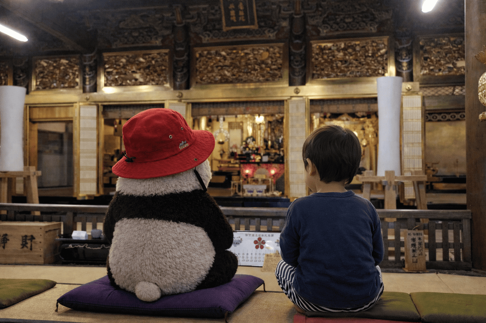</a>
  

灯る堂
黙して座る
小さき背ら
A lit hall—
sitting in silence,
small backs.
  

  

ENGLISH TIP
<ul><li>lit：light（照らす）の過去分詞。a lit hall は明かりのともった堂。</li><li>in silence：黙って、静かに。</li></ul>

  
<a href="/senryu/works/2026-0210-1/" aria-label="作品を個別表示" title="個別ページ">↗</a>

  <a class="image-link" href="/senryu/works/2026-0206-1/" aria-label="作品を個別表示">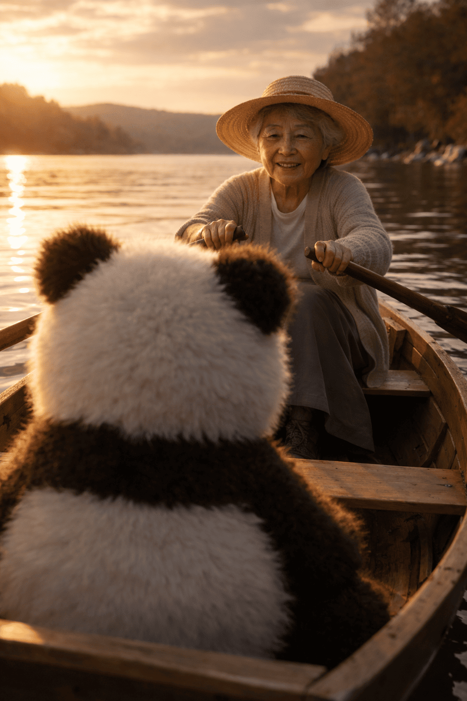</a>
  

夕焼けの
 水を割りゆく
 老婆と熊
 At sunset,
 cutting through the water—
 an old woman and a panda.
  

  

ENGLISH TIP
<ul><li>at sunset：日没時に。</li><li>cut through the water：水を切って進む。cutting は進行中の動きを描く。</li></ul>

  
<a href="/senryu/works/2026-0206-1/" aria-label="作品を個別表示" title="個別ページ">↗</a>

  <a class="image-link" href="/senryu/works/2026-0206-0/" aria-label="作品を個別表示">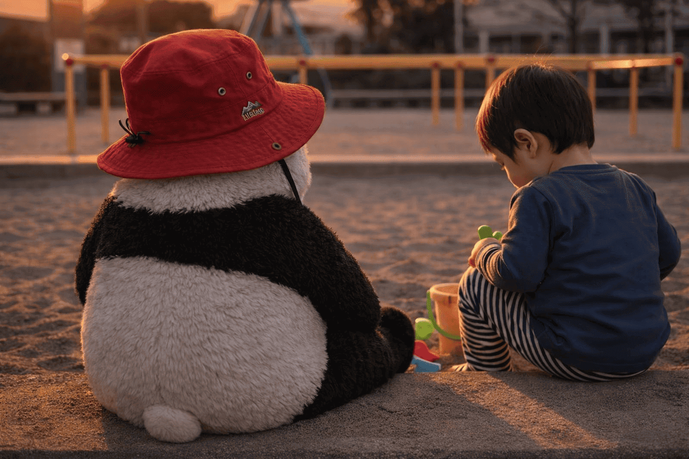</a>
  

遊び終え
言葉のいらぬ
夕間暮れ
Playtime finished,
silence says enough —
evening’s thin edge.
  

  

ENGLISH TIP
<ul><li>Playtime finished：遊びが終わって（詩的な省略表現）。</li><li>silence says enough：沈黙が十分に語る（擬人法）。thin edge は夕暮れのかすかな境目の比喩。</li></ul>

  
<a href="/senryu/works/2026-0206-0/" aria-label="作品を個別表示" title="個別ページ">↗</a>

  <a class="image-link" href="/senryu/works/2026-0202-1/" aria-label="作品を個別表示">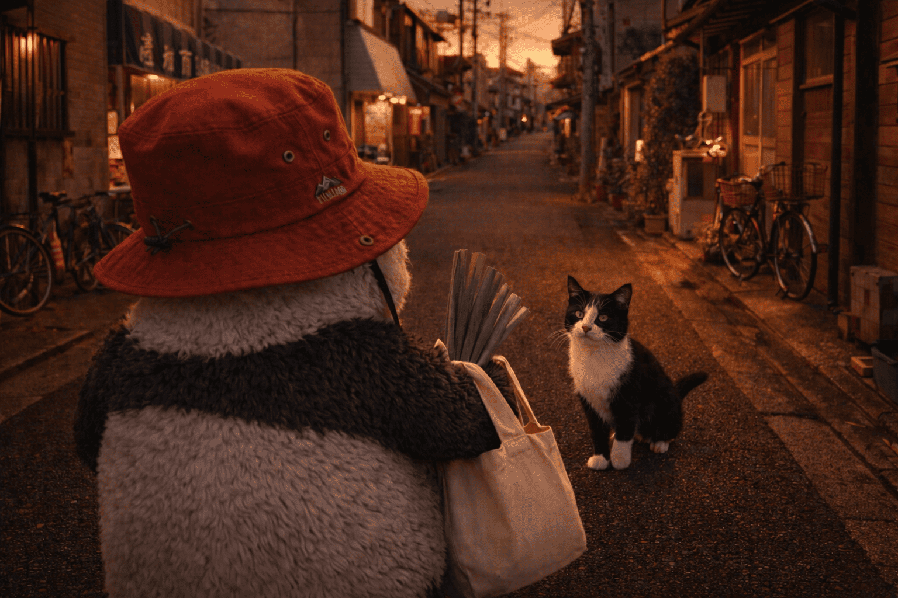</a>
  

葱抱え
似た者同士が
言葉ひらり
Holding green onions,
kindred souls —
words drift lightly.
  

  

ENGLISH TIP
<ul><li>green onions：青ネギ、長ネギなど。</li><li>kindred souls：気の合う者同士。drift lightly は軽やかに漂う。</li></ul>

  
<a href="/senryu/works/2026-0202-1/" aria-label="作品を個別表示" title="個別ページ">↗</a>

  <a class="image-link" href="/senryu/works/2026-0130-3/" aria-label="作品を個別表示">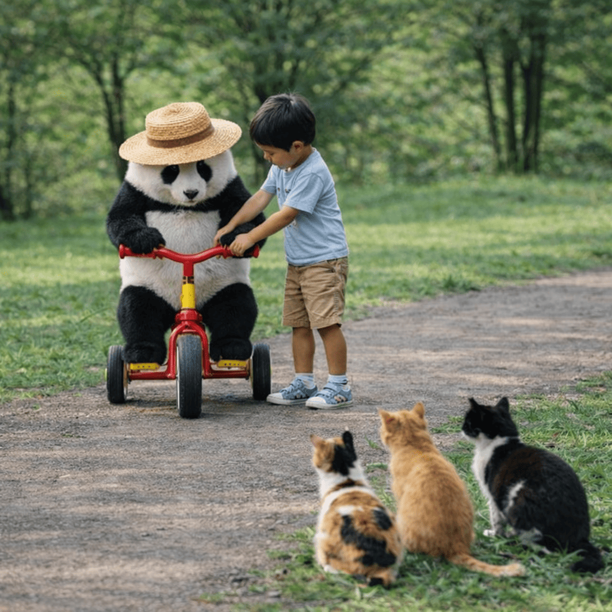</a>
  

漕げぬ熊
教えるは五歳
猫ら見てる
A panda won’t pedal,
taught by a five-year-old —
cats watching closely.
  

  

ENGLISH TIP
<ul><li>pedal：ペダルをこぐ。won’t はここではこごうとしない、という含みもある。</li><li>a five-year-old：5歳児。taught by は〜に教えられて、の意味。</li></ul>

  
<a href="/senryu/works/2026-0130-3/" aria-label="作品を個別表示" title="個別ページ">↗</a>

  <a class="image-link" href="/senryu/works/2026-0130-1/" aria-label="作品を個別表示">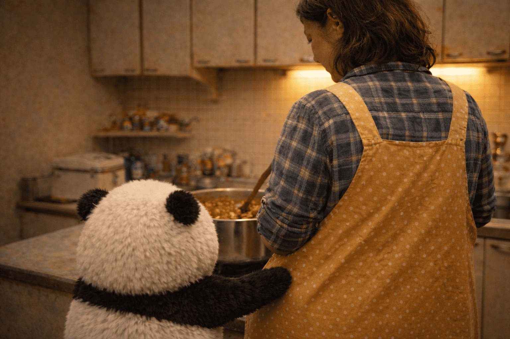</a>
  

たけのこは
ちゃんと入れたの
パンダは問う
Did you remember
to add the bamboo shoots?
the panda asks.
  

  

ENGLISH TIP
<ul><li>remember to do：忘れずに〜する（remember doing は〜したことを覚えている）。</li><li>bamboo shoots：タケノコ。add は料理などに加える。</li></ul>

  
<a href="/senryu/works/2026-0130-1/" aria-label="作品を個別表示" title="個別ページ">↗</a>

  <a class="image-link" href="/senryu/works/2026-0130-0/" aria-label="作品を個別表示">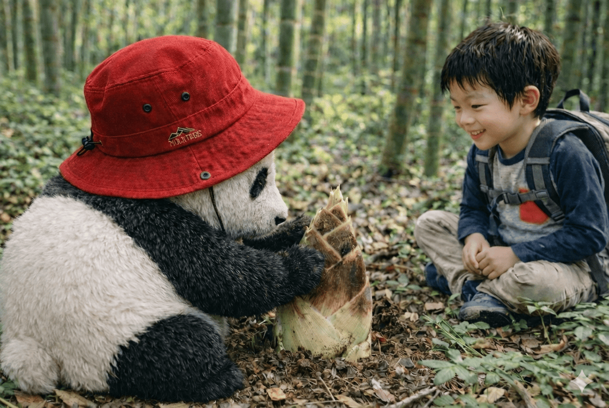</a>
  

たけのこや
土のぬくもり
掌に
Bamboo shoot —
the warmth of the soil
rests in my palm
  

  

ENGLISH TIP
<ul><li>warmth：ぬくもり。warm の名詞形。</li><li>soil：土壌。rest in my palm は手のひらに静かに収まる、という表現。</li></ul>

  
<a href="/senryu/works/2026-0130-0/" aria-label="作品を個別表示" title="個別ページ">↗</a>

  <a class="image-link" href="/senryu/works/2026-0128-0/" aria-label="作品を個別表示">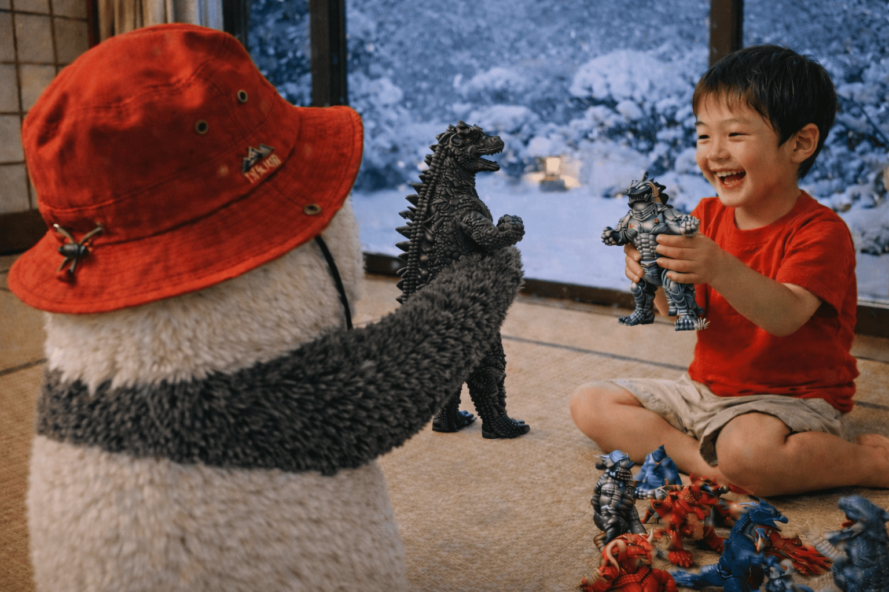</a>
  

雪深し
畳の上の
大決戦
Deep in winter snow,
the tatami floor becomes
a final showdown.
  

  

ENGLISH TIP
<ul><li>deep in winter snow：冬の深い雪の中で。</li><li>showdown：決着をつける対決。becomes a final showdown は床を対決そのものに見立てた詩的表現。</li></ul>

  
<a href="/senryu/works/2026-0128-0/" aria-label="作品を個別表示" title="個別ページ">↗</a>

  <a class="image-link" href="/senryu/works/2026-0127-0/" aria-label="作品を個別表示">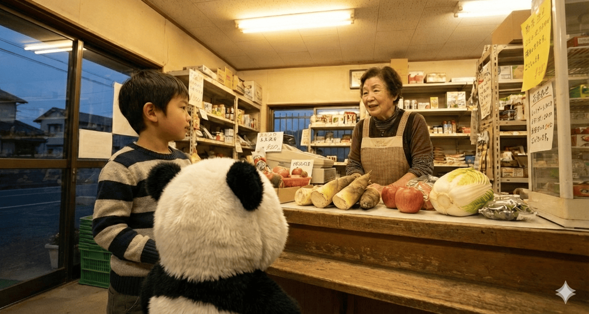</a>
  

竹の子の
お菓子はないのと
パンダ連れ
Bamboo shoots at the counter —
asking for snacks like these,
a panda in tow
  

  

ENGLISH TIP
<ul><li>at the counter：カウンターで。</li><li>in tow：連れ立って、後ろに従えて。a panda in tow はパンダを連れて、の意味。</li></ul>

  
<a href="/senryu/works/2026-0127-0/" aria-label="作品を個別表示" title="個別ページ">↗</a>

  <a class="image-link" href="/senryu/works/2026-0124-0/" aria-label="作品を個別表示">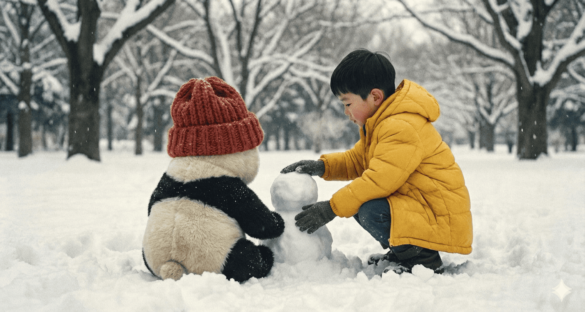</a>
  

雪だるま
俺の弟
パンダは思う
A snowman,
my little brother,
the panda thinks.
  

  

ENGLISH TIP
<ul><li>snowman：雪だるま（複数形 snowmen）。</li><li>little brother：弟。the panda thinks はパンダはそう思う、という語りの表現。</li></ul>

  
<a href="/senryu/works/2026-0124-0/" aria-label="作品を個別表示" title="個別ページ">↗</a>

  <a class="image-link" href="/senryu/works/2026-0123-0/" aria-label="作品を個別表示">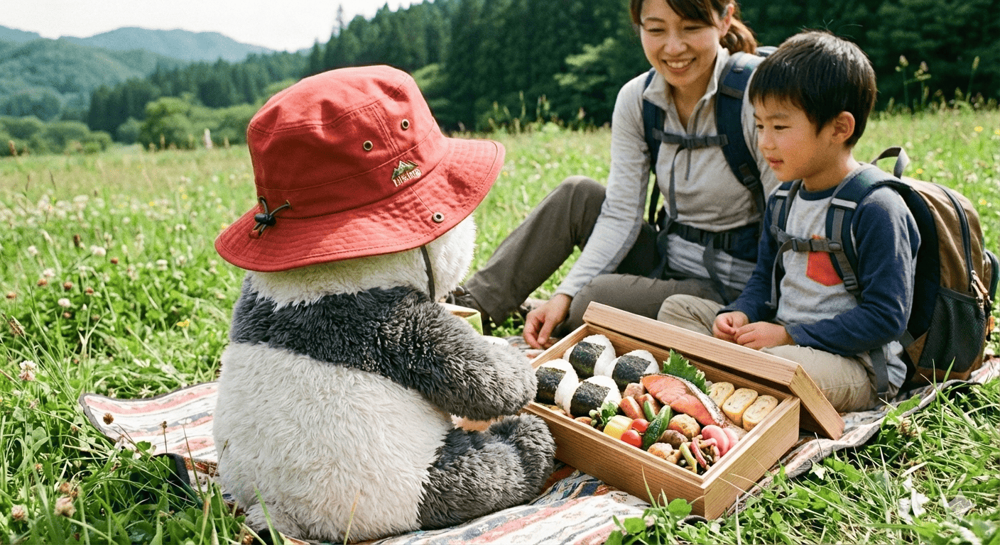</a>
  

頂上より
弁当たべるの
本気だす
Before the summit,
I open my lunchbox.
Serious mode: on.
  

  

ENGLISH TIP
<ul><li>summit：山頂、頂上。</li><li>lunchbox：弁当箱。Serious mode: on. は本気モード起動、という遊び心のある省略表現。</li></ul>

  
<a href="/senryu/works/2026-0123-0/" aria-label="作品を個別表示" title="個別ページ">↗</a>

  <a class="image-link" href="/senryu/works/2026-0122-2/" aria-label="作品を個別表示">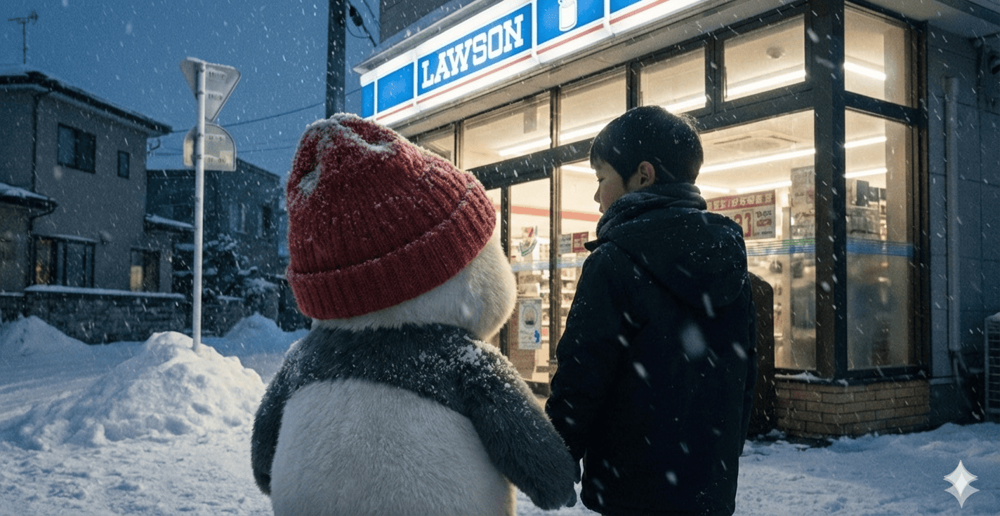</a>
  

帰り道 
買うのは肉まん
ぬくもりも
Heading home,
the thought of steamed buns,
and warmth.
  

  

ENGLISH TIP
<ul><li>head home：家に向かう。</li><li>steamed buns：蒸しパンや中華まん。肉まんを明示するなら steamed meat buns とも言える。</li></ul>

  
<a href="/senryu/works/2026-0122-2/" aria-label="作品を個別表示" title="個別ページ">↗</a>

  <a class="image-link" href="/senryu/works/2026-0122-0/" aria-label="作品を個別表示">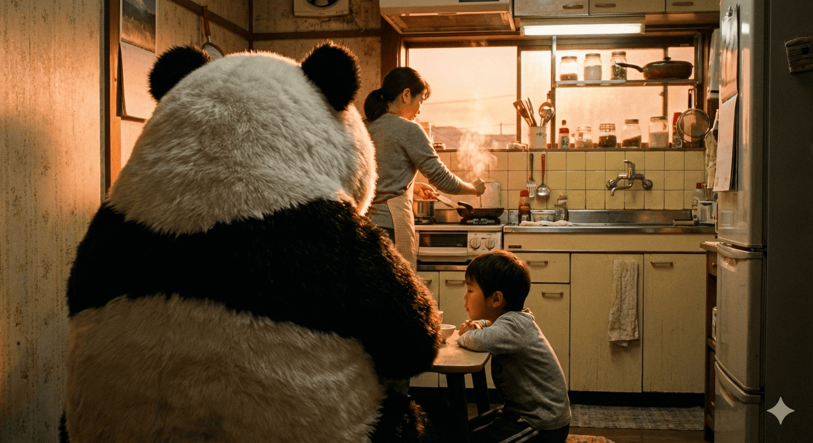</a>
  

待つ背中
竹の子の香り
先に来る
Waiting back,
the scent of bamboo shoots
arrives first.
  

  

ENGLISH TIP
<ul><li>scent：香り、におい。</li><li>arrive first：先に到着する。Waiting back は待つ後ろ姿を描く詩的断片で、日常英語なら a waiting figure などが自然。</li></ul>

  
<a href="/senryu/works/2026-0122-0/" aria-label="作品を個別表示" title="個別ページ">↗</a>

  <a class="image-link" href="/senryu/works/2026-0121-1/" aria-label="作品を個別表示">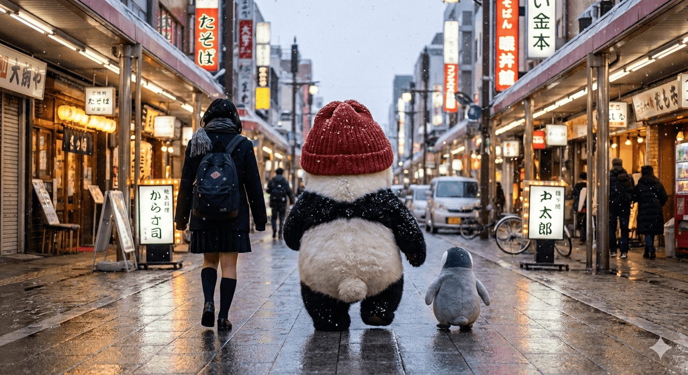</a>
  

雪しんしん
パンダペンギン
うれしそう
Soft, steady snow. 
Panda and penguin,
full of joy.
  

  

ENGLISH TIP
<ul><li>steady：途切れない、一定の。</li><li>full of joy：喜びでいっぱいの。</li></ul>

  
<a href="/senryu/works/2026-0121-1/" aria-label="作品を個別表示" title="個別ページ">↗</a>

  <a class="image-link" href="/senryu/works/2026-0120-0/" aria-label="作品を個別表示">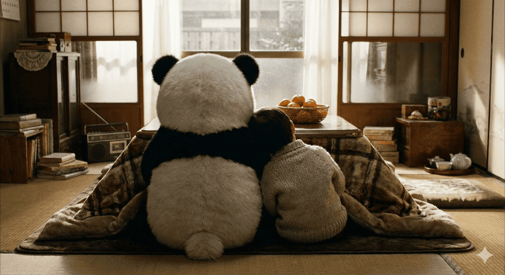</a>
  

背ふたつ
話さぬことで
近くなる
Two backs together,
saying nothing,
growing closer.
  

  

ENGLISH TIP
<ul><li>say nothing：何も言わない。</li><li>grow closer：親しくなる、距離が縮まる。growing は徐々に変化する様子を表す。</li></ul>

  
<a href="/senryu/works/2026-0120-0/" aria-label="作品を個別表示" title="個別ページ">↗</a>

  <a class="image-link" href="/senryu/works/rain/" aria-label="作品を個別表示">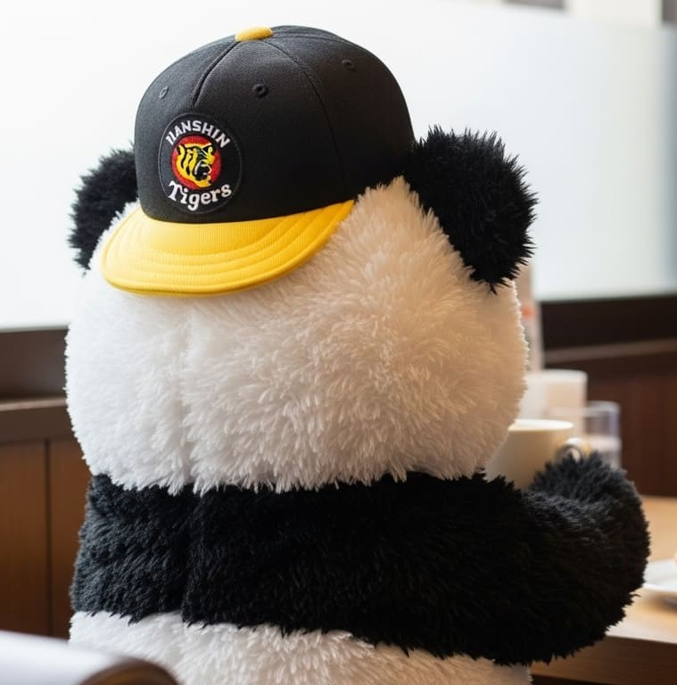</a>
  

来ぬ友を
待ち続けている
切なさよ 
Waiting still
for friends who never come.
Such quiet ache.

  

ENGLISH TIP
<ul><li>wait for：〜を待つ。still はここでは今もなお。</li><li>quiet ache：静かな心の痛み。ache は身体的な痛みだけでなく心の痛みにも使う。</li></ul>

  
<a href="/senryu/works/rain/" aria-label="作品を個別表示" title="個別ページ">↗</a>

  <a class="image-link" href="/senryu/works/forecast/" aria-label="作品を個別表示">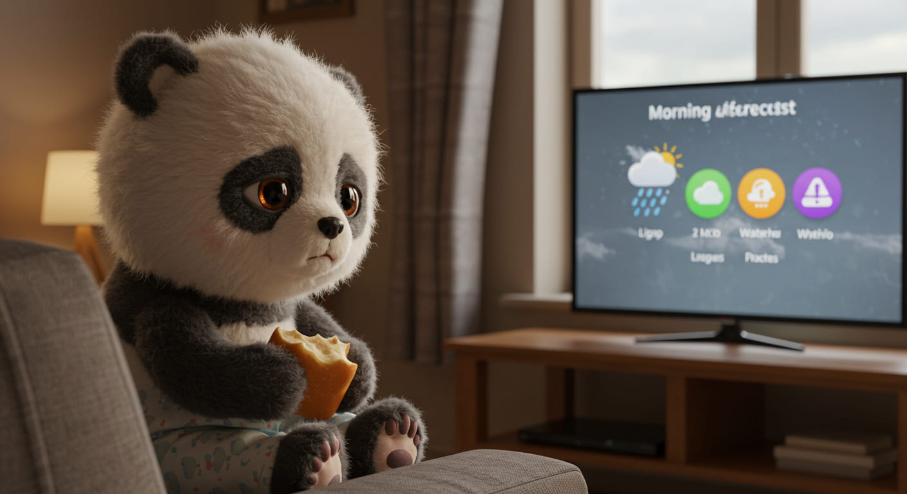</a>
  

雨予報
パンをかじって
ため息を
Rain in the forecast.
A bite of bread
and a quiet sigh.
  

  

ENGLISH TIP
<ul><li>in the forecast：予報に出ている。</li><li>a bite of bread：パンのひと口。sigh はため息（名詞・動詞）。</li></ul>

  
<a href="/senryu/works/forecast/" aria-label="作品を個別表示" title="個別ページ">↗</a>

  <a class="image-link" href="/senryu/works/2026-0114-0/" aria-label="作品を個別表示">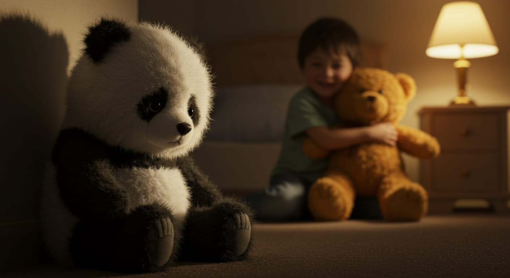</a>
  

テディベア
あの子の愛情
持ってった
Teddy bear,
you carried away
the love meant for me.

  

ENGLISH TIP
<ul><li>carry away：持ち去る。</li><li>meant for me：私に向けられた、私のための（meant は過去分詞）。</li></ul>

  
<a href="/senryu/works/2026-0114-0/" aria-label="作品を個別表示" title="個別ページ">↗</a>

